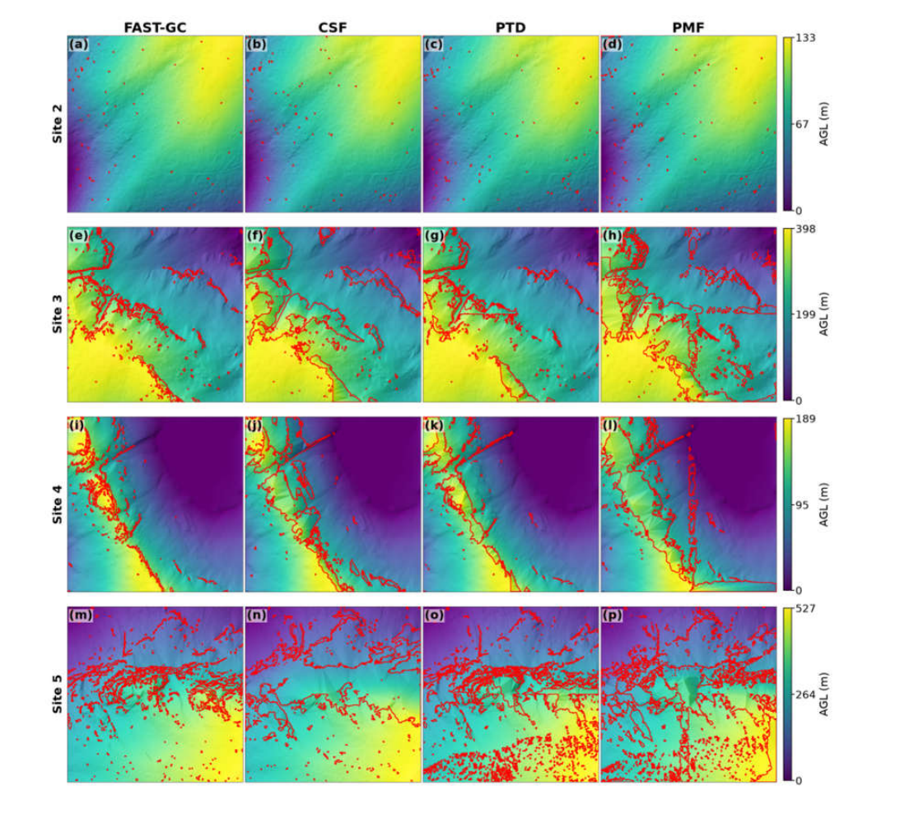
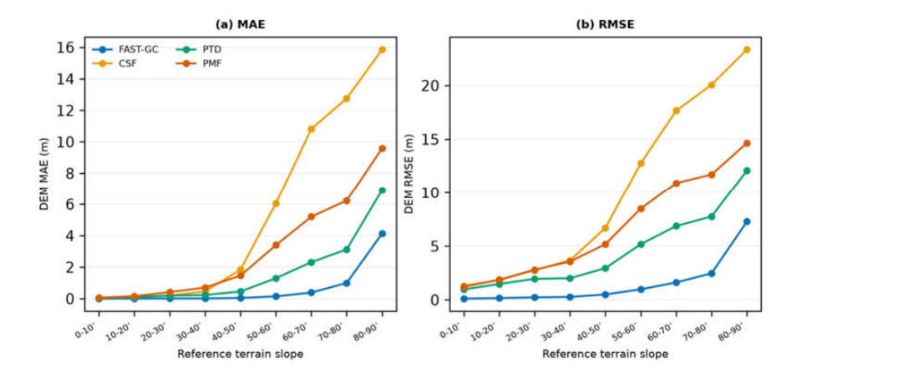
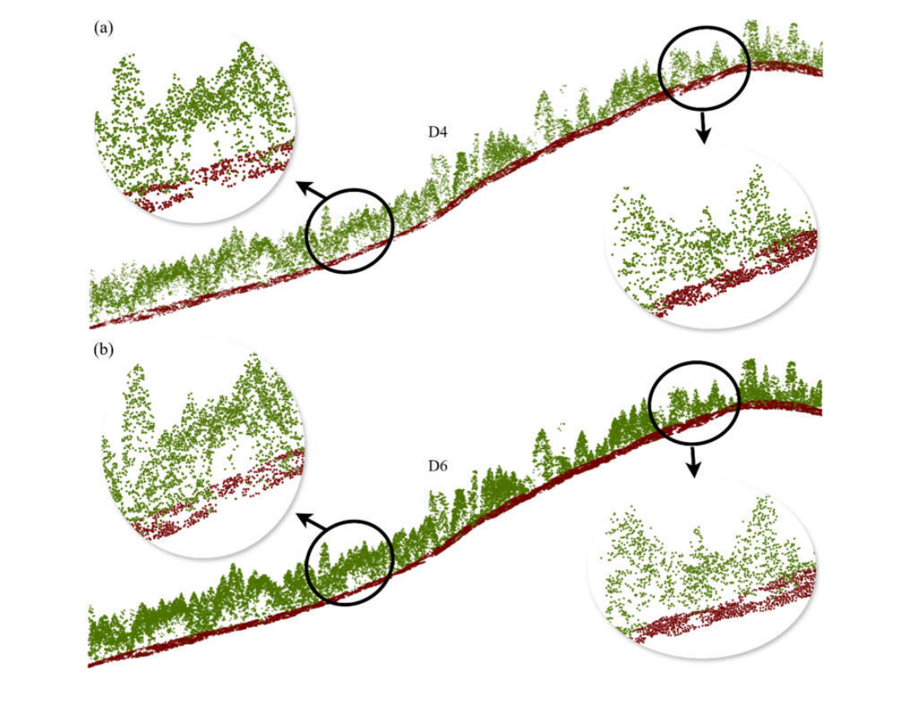
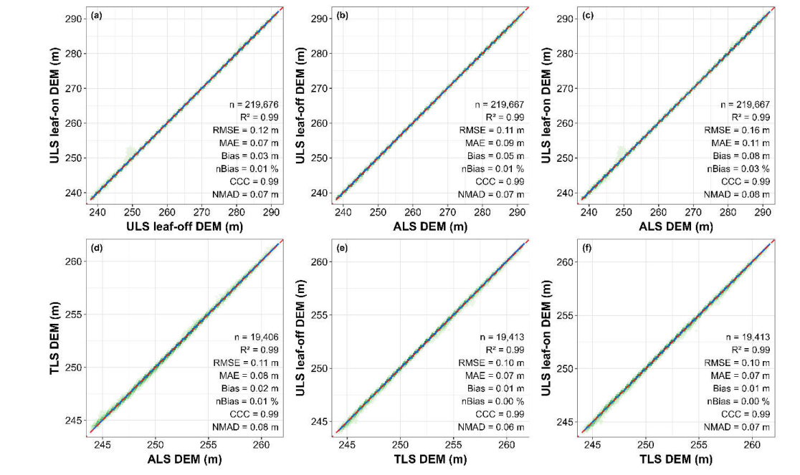

# Chapter 1 — FAST-GC: Ground Classification Across Heterogeneous LiDAR Observations

FAST-GC (**Fully Adaptive Self-Tuning Ground Classification**) provides an automated framework for separating ground and non-ground LiDAR returns and reconstructing terrain surfaces from airborne laser scanning (ALS), UAV laser scanning (ULS), and terrestrial laser scanning (TLS) observations. The algorithm adapts terrain-support estimation internally to the acquisition geometry, sampling characteristics, and local terrain conditions, thereby reducing dependence on scene-specific parameter calibration. This chapter presents the principal classification and terrain-reconstruction evidence, followed by a concise operational introduction.

## 1.1 Why ground classification matters

Ground-point classification is a fundamental stage in LiDAR data processing because omission of legitimate ground returns and inclusion of non-ground observations propagate into digital elevation models (DEMs), height normalization, canopy-height models, and subsequent geospatial products. The classification challenge varies with terrain gradient, canopy cover, ground-return availability, and sensor acquisition geometry. FAST-GC addresses these variations through internally adaptive processing rather than requiring users to recalibrate classification settings for each scene. The method remains algorithmically parameterized; its *self-tuning* character refers specifically to the absence of scene-specific manual parameter calibration in the evaluated workflows.

## 1.2 Preserving terrain morphology: comparison with established filters

The controlled comparison used ALS observations from the southern Sierra Nevada Mountains, California, originally compiled by **Jin et al. (2020)**. The source dataset contains twenty 500 × 500 m sites spanning contrasting forest cover and topographic conditions. For the controlled evaluation, the selected source blocks were renumbered; comparison Sites 2–5 correspond to original Jin et al. blocks 1, 12, 13, and 15, respectively. Figure 1.1 compares 0.5 m DEMs generated from FAST-GC, Cloth Simulation Filtering (CSF), Progressive TIN Densification (PTD), and Progressive Morphological Filtering (PMF). Although all four algorithms recover the broad terrain gradient, their ability to preserve local terrain morphology diverges as topographic complexity increases. Spatially contiguous elevation discrepancies are more extensive for the conventional filters in the more demanding terrain scenes.



*Figure 1.1. Comparison of 0.5 m digital elevation models derived from FAST-GC, CSF, PTD, and PMF across selected southern Sierra Nevada ALS benchmark sites (Jin et al., 2020; comparison Sites 2–5, original blocks 1, 12, 13, and 15). Elevations are normalized relative to the minimum terrain elevation within each site. Red polygon boundaries identify spatially contiguous areas where the absolute difference from the reference DEM derived from original ground-classified returns (class 2) is at least 0.25 m. Rows represent sites and columns represent classification methods.*

## 1.3 Robustness across steep slopes and reduced point density

Terrain reconstruction errors exhibit a pronounced dependence on reference terrain slope (Figure 1.2). Cell-level DEM residuals from the same Sierra Nevada benchmark were pooled within 10° slope intervals to evaluate mean absolute error (MAE) and root mean square error (RMSE). Differences among algorithms remained comparatively limited under gentle terrain conditions but increased substantially toward steeper slopes. At 70–80°, FAST-GC achieved a DEM MAE of **1.00 m**, compared with **3.12–12.75 m** for the evaluated conventional filters. These results demonstrate greater preservation of complex terrain within the controlled benchmark, rather than invariant accuracy across all landscapes.



*Figure 1.2. Slope-dependent terrain reconstruction errors for FAST-GC, CSF, PTD, and PMF using the Jin et al. (2020) southern Sierra Nevada ALS benchmark (comparison Sites 2–5). Cell-level residuals between method-derived and reference 0.5 m DEMs are grouped into 10° reference-slope classes and summarized as (a) mean absolute error and (b) root mean square error. Increasing errors with slope indicate progressive loss of terrain-reconstruction accuracy.*

The availability of terrain-supporting observations also changes with LiDAR sampling density. Figure 1.3 illustrates ground and non-ground separation along the same representative ALS terrain profile after deterministic thinning to approximately **4 and 6 points/m²**. Ground classification remains visually coherent beneath vegetation and across varying terrain conditions. In the wider twenty-site Sierra Nevada assessment, a reduction in median point density from **9.84 to 3.84 points/m²** maintained F1-score near **0.97** and intersection-over-union near **0.95**, while DEM MAE increased from **0.07 to 0.11 m**. These findings indicate that reduced sampling support need not translate directly into a proportional loss of classification agreement, although terrain-surface error remains sensitive to the available ground observations.



*Figure 1.3. FAST-GC ground classification under reduced ALS point densities using the Jin et al. (2020) southern Sierra Nevada benchmark. The same representative terrain profile is shown after deterministic thinning to (a) D4 (approximately 4 points/m²) and (b) D6 (approximately 6 points/m²). Red points indicate classified ground returns and green points indicate non-ground vegetation returns. Circled locations and enlarged insets illustrate ground–non-ground separation under contrasting local terrain and canopy conditions.*

## 1.4 Cross-platform consistency: ALS, ULS, and TLS

Cross-platform consistency was evaluated using the central European forest LiDAR dataset of **Weiser et al. (2022)**, specifically plot **BR01 in Bretten, Baden-Württemberg, Germany**. The independently acquired ALS, TLS, and ULS observations differ in sampling geometry, point density, acquisition date, and canopy condition. Accordingly, correspondence was assessed at the terrain-surface level rather than by direct point-wise comparison. FAST-GC ground returns were used to reconstruct independent **0.5 m DEMs**, and spatially coincident cells were compared across six platform and canopy-condition combinations (Figure 1.4). Across the common footprints, the DEMs exhibited **R² and concordance correlation coefficients of at least 0.99**, with **RMSE of 0.10–0.16 m**. The ULS-based comparisons covered **5.47 ha**, whereas comparisons involving TLS were restricted to **0.48 ha**. The results indicate strong terrain-surface correspondence despite substantial differences in the underlying LiDAR observations.



*Figure 1.4. Cross-platform correspondence of independently reconstructed 0.5 m DEMs at forest plot BR01, Bretten, Germany, from the multi-platform dataset of Weiser et al. (2022). Panels compare (a) ULS leaf-off versus leaf-on, (b) ALS versus ULS leaf-off, (c) ALS versus ULS leaf-on, (d) ALS versus TLS, (e) TLS versus ULS leaf-off, and (f) TLS versus ULS leaf-on. Hexagonal bins represent paired DEM-cell elevations; dashed red lines indicate 1:1 correspondence and blue lines indicate fitted regressions. Comparisons use overlapping footprints of 5.47 ha for ULS-based pairs and 0.48 ha for pairs involving TLS. The results characterize terrain-surface agreement, not point-wise classification accuracy.*

## 1.5 Install FAST-GC

!!! note "Book versus software"
    The **FAST-GC Book** is documentation only. You do not need to install the book to process LiDAR data. The commands below install and run the separate **FAST-GC** package.

The FAST-GC v0.2.1 release documentation lists support for **Python 3.12–3.14**. Check the package's current release requirements before installing a later version.

### Recommended installation

In a terminal with an appropriate Python installation:

```powershell
python -m pip install fastgc
```

Verify that the command-line application is available:

```powershell
fastgc --version
fastgc --help
```

If you intend to develop FAST-GC itself, consult the package repository's installation guidance rather than the documentation-book setup.

## 1.6 Prepare your first LiDAR file

For the introductory workflow, use an existing `.las` or `.laz` point cloud and note its acquisition platform. Place the file in a working directory, or supply its full path.

The following example assumes an **ALS** file named `input.laz`. Replace that filename and sensor mode with the values appropriate to your data.

!!! tip "Input data"
    Start with a small, representative file so that you can inspect the classification visually before running a larger batch.

## 1.7 Run your first ground classification

The FAST-GC release README documents this basic command:

```powershell
fastgc --in_path "input.laz" --sensor_mode ALS --products FAST_GC
```

To specify a destination directory explicitly:

```powershell
fastgc --in_path "input.laz" --out_dir "FASTGC_output" --sensor_mode ALS --products FAST_GC
```

| Argument | Purpose |
| --- | --- |
| `--in_path` | Path to the input point cloud |
| `--sensor_mode` | Acquisition mode: `ALS`, `ULS`, or `TLS` |
| `--products FAST_GC` | Request the ground-classification product |
| `--out_dir` | Specify an output directory |

These examples show the documented interface, **not an execution performed for this book**. File naming and the complete output directory layout should be confirmed from a real run before adding an output-tree example.


## 1.8 Closing perspective

The comparative assessments demonstrate that ground-point classification performance is governed not only by point-wise classification agreement but also by the capacity to preserve terrain morphology under increasing topographic complexity, reduced sampling support, and contrasting acquisition geometries. Across the evaluated datasets, FAST-GC maintained comparatively stable classification and terrain-reconstruction performance without scene-specific parameter calibration. The cross-platform analysis further demonstrated close correspondence among independently reconstructed ALS, ULS, and TLS terrain surfaces. These findings establish the practical relevance of sensor-adaptive ground classification for heterogeneous LiDAR observations, while recognizing that reconstruction uncertainty remains dependent on terrain and ground-return availability. Algorithmic details and additional evaluations are addressed in Chapter 3.

**Dataset references and advanced reading.** The southern Sierra Nevada ALS benchmark is from Jin et al. (2020); the multi-platform German forest observations are from Weiser et al. (2022). For full dataset citations, experimental protocols, and methodological details, see Fareed, N., Numata, I., Silva, C. A., & Prichard, S. J. (2026), *FAST-GC: A Fully Adaptive Self-Tuning Ground Classification Algorithm for Multi-Platform LiDAR Sensors*, [research preprint](https://doi.org/10.20944/preprints202609.1631.v1) (not peer-reviewed).
