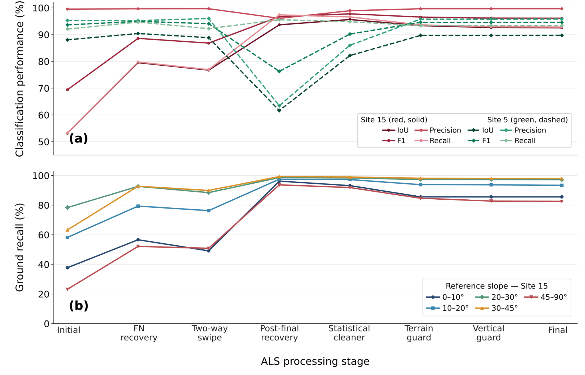
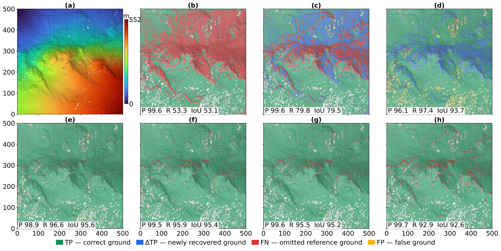

# Chapter 2 — Installation, Configuration, and Performance Optimization

**Documentation release:** FAST-GC v0.2.1  
**Scope:** installation, environment checks, and FAST_GC-only speed tests. Detailed FAST_DEM, FAST_CHM, and other product validation is reserved for their respective chapters.

## 2.1 Installation overview

FAST-GC is a Python command-line application for ground classification of airborne (ALS), UAV (ULS), and terrestrial (TLS) LiDAR data. Release **0.2.1** declares Python **3.12–3.14** compatibility. The tested installation environments used Python 3.12.15 on Windows and Ubuntu WSL2, and Python 3.13 in Google Colab. Use an isolated environment; avoid changing your operating system's Python interpreter.

| Installation pathway | System | Evidence |
|---|---|---|
| Conda environment + PyPI | Windows 11 Pro | Installation, `pip check`, `fastgc-check`, CLI and imports passed |
| Python `venv` + PyPI | Windows 11 Pro | Installation, dependencies, CLI and imports passed |
| GitHub editable installation | Windows 11 Pro | Editable build, dependencies, CLI and source import passed |
| `uv` + PyPI | Ubuntu 22.04.5 LTS on WSL2 | Installation, 23 dependency packages, checks and CLI passed |
| PyPI in Google Colab | Hosted Linux, Python 3.13 | Installation and an ALS run completed previously |
| Native Ubuntu (not WSL2) | — | Not independently tested |
| macOS Intel / Apple Silicon | — | Guidance only; not independently tested |

### Reference hardware and software

| Property | Tested configuration |
|---|---|
| Workstation | Dell G16 7620 |
| CPU | Intel Core i9-12900H, 14 physical cores / 20 logical processors |
| Host RAM | Approximately 31.69 GiB |
| Windows | Windows 11 Pro |
| Linux | Ubuntu 22.04.5 LTS on WSL2; Linux-reported available RAM approximately 27.4 GiB during the benchmark |
| Windows and WSL2 Python | 3.12.15 |
| FAST-GC | 0.2.1 |
| Reference point cloud | Site5 ALS, approximately 3.5 million points; source Site 15 in Jin et al. (2020) |

A GPU is **not required** for the tested core FAST_GC workflow. RAM and disk needs depend on point count, density, tile dimensions, and concurrency; 16 GiB or more is a practical recommendation for substantial datasets, not a formal minimum.

## 2.2 Windows: Conda + PyPI

Open **PowerShell** with Conda available. The following block creates an isolated environment, installs the pinned release, and checks it.

```powershell
conda create -n fastgc python=3.12 pip -y
conda activate fastgc
python -m pip install fastgc==0.2.1
python -m pip check
fastgc-check
fastgc --version
fastgc --help
```

Expected version: `fastgc 0.2.1`. If the installation command succeeds but `fastgc` is not recognized, check that the correct environment is active with `conda info --envs` and `Get-Command fastgc`.

**One-paste PowerShell installation** (no activation required):

```powershell
conda create -n fastgc python=3.12 pip -y; if ($LASTEXITCODE -ne 0) { throw 'Conda environment failed' }; conda run -n fastgc python -m pip install fastgc==0.2.1; if ($LASTEXITCODE -ne 0) { throw 'FAST-GC installation failed' }; conda run -n fastgc python -m pip check; if ($LASTEXITCODE -ne 0) { throw 'Dependency check failed' }; conda run -n fastgc fastgc-check; if ($LASTEXITCODE -ne 0) { throw 'FAST-GC check failed' }; conda run -n fastgc fastgc --version
```

## 2.3 Windows: Python `venv` + PyPI

This method requires an installed Python 3.12 interpreter accessible through the Windows Python launcher.

```powershell
py -3.12 --version
py -3.12 -m venv "$HOME\fastgc_venv"
& "$HOME\fastgc_venv\Scripts\python.exe" -m pip install fastgc==0.2.1
& "$HOME\fastgc_venv\Scripts\python.exe" -m pip check
& "$HOME\fastgc_venv\Scripts\fastgc-check.exe"
& "$HOME\fastgc_venv\Scripts\fastgc.exe" --version
```

Using the environment executables directly avoids PowerShell execution-policy issues. To activate interactively when permitted:

```powershell
& "$HOME\fastgc_venv\Scripts\Activate.ps1"
```

**One-paste PowerShell installation:**

```powershell
py -3.12 -m venv "$HOME\fastgc_venv"; if ($LASTEXITCODE -ne 0) { throw 'venv creation failed' }; & "$HOME\fastgc_venv\Scripts\python.exe" -m pip install fastgc==0.2.1; if ($LASTEXITCODE -ne 0) { throw 'Install failed' }; & "$HOME\fastgc_venv\Scripts\python.exe" -m pip check; if ($LASTEXITCODE -ne 0) { throw 'Dependency check failed' }; & "$HOME\fastgc_venv\Scripts\fastgc-check.exe"; if ($LASTEXITCODE -ne 0) { throw 'Diagnostic failed' }; & "$HOME\fastgc_venv\Scripts\fastgc.exe" --version
```

## 2.4 Windows: GitHub source / editable installation

Use editable installation if you plan to inspect or modify FAST-GC source code. The pinned release tag provides a more reproducible baseline than an unspecified development branch.

```powershell
conda create -n fastgc_source python=3.12 pip -y
conda activate fastgc_source
git clone https://github.com/nadeemfareed/FAST-GC.git
cd FAST-GC
git checkout v0.2.1
python -m pip install -e .
python -m pip check
fastgc-check
fastgc --version
python -c "import fastgc; print(fastgc.__file__)"
git rev-parse HEAD
```

The Windows editable-installation test succeeded against the repository default branch reporting version 0.2.1; the exact tested commit was not independently recorded. The explicit `git checkout v0.2.1` above is a reproducibility recommendation, not a claim that the test used that tag.

**One-paste PowerShell source installation:**

```powershell
conda create -n fastgc_source python=3.12 pip -y; if ($LASTEXITCODE -ne 0) { throw 'Conda failed' }; git clone https://github.com/nadeemfareed/FAST-GC.git "$HOME\FAST-GC"; if ($LASTEXITCODE -ne 0) { throw 'Clone failed; check whether target already exists' }; git -C "$HOME\FAST-GC" checkout v0.2.1; if ($LASTEXITCODE -ne 0) { throw 'Checkout failed' }; conda run -n fastgc_source python -m pip install -e "$HOME\FAST-GC"; if ($LASTEXITCODE -ne 0) { throw 'Install failed' }; conda run -n fastgc_source fastgc-check; if ($LASTEXITCODE -ne 0) { throw 'Diagnostic failed' }; conda run -n fastgc_source fastgc --version
```

The one-paste command assumes `$HOME\FAST-GC` does not already exist.

## 2.5 Ubuntu 22.04 and WSL2: `uv` installation

Ubuntu 22.04's system Python 3.10 is below FAST-GC v0.2.1's minimum. Do **not** replace system Python. Install Python 3.12 into an isolated `uv` environment instead.

From **Windows PowerShell**, enter Ubuntu:

```powershell
wsl -d Ubuntu-22.04
```

Then in the **Ubuntu shell**:

```bash
curl -LsSf https://astral.sh/uv/install.sh | sh
export PATH="$HOME/.local/bin:$PATH"
uv python install 3.12
uv venv --python 3.12 "$HOME/fastgc_env"
uv pip install --python "$HOME/fastgc_env/bin/python" fastgc==0.2.1
uv pip check --python "$HOME/fastgc_env/bin/python"
"$HOME/fastgc_env/bin/fastgc-check"
"$HOME/fastgc_env/bin/fastgc" --version
```

**One-paste installation directly from Windows PowerShell** (requires WSL2 and `Ubuntu-22.04` already installed):

```powershell
wsl -d Ubuntu-22.04 -- bash -lc 'set -e; export PATH="$HOME/.local/bin:$PATH"; if ! command -v uv >/dev/null 2>&1; then curl -LsSf https://astral.sh/uv/install.sh | sh; fi; uv python install 3.12; uv venv --python 3.12 "$HOME/fastgc_env"; uv pip install --python "$HOME/fastgc_env/bin/python" fastgc==0.2.1; uv pip check --python "$HOME/fastgc_env/bin/python"; "$HOME/fastgc_env/bin/fastgc-check"; "$HOME/fastgc_env/bin/fastgc" --version'
```

Windows paths such as `C:\data\Site5.las` are accessed from WSL2 as `/mnt/c/data/Site5.las`. For tiled workloads, using Linux-native output storage under `$HOME` is a practical starting point; the speed impact of storage location was not isolated in these tests.

## 2.6 Google Colab

Run the following in **Colab notebook cells**:

```python
%pip install fastgc==0.2.1
```

```python
import sys, importlib.metadata
print(sys.version)
print(importlib.metadata.version('fastgc'))
```

```python
!fastgc-check
!fastgc --version
!fastgc --help
```

For input stored in Google Drive:

```python
from google.colab import drive
drive.mount('/content/drive')
```

A FAST_GC-only example, assuming the file exists:

```python
!fastgc --in_path '/content/drive/MyDrive/Site5.las' --out_dir '/content/FASTGC_OUTPUT' --sensor_mode ALS --workflow run --products FAST_GC
```

Colab CPU and memory allocations vary. `/content` is temporary; copy results to persistent storage before the runtime ends. A GPU runtime is not required for the tested FAST_GC workflow.

## 2.7 Local Jupyter Notebook and JupyterLab

Install Jupyter in the **same environment** as FAST-GC, then register the kernel:

```powershell
conda activate fastgc
python -m pip install jupyterlab ipykernel
python -m ipykernel install --user --name fastgc --display-name 'Python (FAST-GC)'
jupyter lab
```

Select **Python (FAST-GC)** as the notebook kernel. In an existing notebook, `%pip install fastgc==0.2.1` targets the current kernel. Restart the kernel after installation if necessary.

Verify the active interpreter:

```python
import sys, importlib.metadata
print('Kernel Python:', sys.executable)
print('FAST-GC:', importlib.metadata.version('fastgc'))
```

For robust multiprocessing, execute the FAST-GC CLI as a subprocess instead of embedding worker creation directly in notebook code:

```python
import os, sys, subprocess, time
from pathlib import Path

exe = Path(sys.executable).parent / ('fastgc.exe' if os.name == 'nt' else 'fastgc')
input_file = r'C:\path\to\Site5.las'   # change to your real path
output_dir = r'C:\path\to\FASTGC_NOTEBOOK_TEST'
cmd = [str(exe), '--in_path', input_file, '--out_dir', output_dir,
       '--sensor_mode', 'ALS', '--workflow', 'tile-run-merge',
       '--products', 'FAST_GC', '--tile_size_m', '140',
       '--buffer_m', '4', '--jobs', '8', '--joblib_backend', 'loky',
       '--joblib_pre_dispatch', '2*n_jobs', '--cleanup_tiles']
env = os.environ.copy()
for k in ('OMP_NUM_THREADS', 'OPENBLAS_NUM_THREADS', 'MKL_NUM_THREADS', 'NUMEXPR_NUM_THREADS'):
    env[k] = '1'
env['LAZRS_NUM_THREADS'] = '2'
t0 = time.perf_counter()
subprocess.run(cmd, env=env, check=True)
print(f'Elapsed: {time.perf_counter() - t0:.2f} s')
```

For Linux notebook kernels, replace the Windows paths with Linux paths.

## 2.8 macOS installation (not independently tested)

With Python 3.12 installed:

```bash
python3.12 -m venv "$HOME/fastgc_env"
source "$HOME/fastgc_env/bin/activate"
python -m pip install fastgc==0.2.1
python -m pip check
fastgc-check
fastgc --version
```

Availability of compatible binary distributions may differ between Intel and Apple Silicon. If source compilation is required, inspect the specific build error before installing compilers or Rust tooling. This chapter does **not** claim verified macOS compatibility.

## 2.9 Standard FAST_GC command interface

The same CLI argument names apply across Windows and Linux. PowerShell is the standard presentation style in this book; Linux equivalents use Bash syntax.

**Minimal PowerShell test** (replace paths):

```powershell
fastgc `
  --in_path 'C:\path\to\small_als_sample.las' `
  --out_dir 'C:\path\to\FASTGC_SMOKE_OUTPUT' `
  --sensor_mode ALS `
  --workflow run `
  --products FAST_GC
```

A small sample checks functional execution, not optimal performance. The sample path is illustrative, not a bundled test asset.

**Tested Windows speed configuration:**

```powershell
conda activate fastgc
$env:OMP_NUM_THREADS = '1'
$env:OPENBLAS_NUM_THREADS = '1'
$env:MKL_NUM_THREADS = '1'
$env:NUMEXPR_NUM_THREADS = '1'
$env:LAZRS_NUM_THREADS = '2'
$IN = 'C:\path\to\Site5.las'
$OUT = 'C:\path\to\FASTGC_SPEED_TEST'
Measure-Command {
    fastgc `
      --in_path $IN `
      --out_dir $OUT `
      --sensor_mode ALS `
      --workflow tile-run-merge `
      --products FAST_GC `
      --tile_size_m 140 `
      --buffer_m 4 `
      --jobs 8 `
      --joblib_backend loky `
      --joblib_pre_dispatch '2*n_jobs' `
      --cleanup_tiles
}
```

**Equivalent Ubuntu FAST_GC-only test:**

```bash
source "$HOME/fastgc_env/bin/activate"
export OMP_NUM_THREADS=1 OPENBLAS_NUM_THREADS=1 MKL_NUM_THREADS=1 NUMEXPR_NUM_THREADS=1 LAZRS_NUM_THREADS=2
time fastgc \
  --in_path '/path/to/Site5.las' \
  --out_dir "$HOME/FASTGC_SPEED_TEST" \
  --sensor_mode ALS \
  --workflow tile-run-merge \
  --products FAST_GC \
  --tile_size_m 140 \
  --buffer_m 4 \
  --jobs 8 \
  --joblib_backend loky \
  --joblib_pre_dispatch '2*n_jobs' \
  --cleanup_tiles
```

For reproducible timing, use a **fresh output directory**. The correct FAST-GC v0.2.1 tile buffer flag is `--buffer_m`, **not** `--tile_buffer_m`. The available workflows and flags should always be checked using `fastgc --help` for the installed release.

## 2.10 Performance optimization

### Worker scaling on the reference Windows workstation

Site5 ALS, FAST_GC-only, 140 m tiles, 4 m buffer, `tile-run-merge`:

| Workers | Wall time (s) | Speedup versus 1 worker |
|---:|---:|---:|
| 1 | 2085.38 | 1.00× |
| 2 | 1185.86 | 1.76× |
| 4 | 755.59 | 2.76× |
| 6 | 633.45 | 3.29× |
| **8** | **600.87** | **3.47×** |
| 10 | Approximately 903 | Approximately 2.31× |

Eight workers were fastest **among the tested configurations on this workstation**. Ten workers performed worse, illustrating scheduling, memory, or I/O contention beyond the practical optimum. Individual runs were measured; confidence intervals and repeat-run statistics were not established.

### Tile geometry

| Tile size | Buffer | Workers | Tiles | Runtime |
|---|---|---:|---:|---:|
| 140 m | 4 m | 8 | 16 | 600.87 s |
| 50 m | 3 m | 8 | 100 | 830.39 s |

The 50 m configuration was approximately 38.2% slower. Buffer width also changed, so this is **not** a controlled tile-size-only experiment. Smaller tiles can reduce per-task memory while increasing scheduling and intermediate-file overhead; larger tiles do the reverse.

### Ubuntu WSL2 execution observation

A completed WSL2 Site5 run used 140 m tiles, 4 m buffer, eight `loky` workers, and requested **FAST_GC, FAST_DEM, and FAST_CHM**. It completed 16/16 tiles without reported failures, with FAST_GC classification taking approximately **5 min 04 s** and full shell wall time **338.395 s (5 min 38 s)**. The merged FAST_GC point count was **3,503,054**. The application's internal FAST-GC total was **312.72 s**.

The earlier Windows FAST_GC-only run took **600.87 s**, so the observed Linux wall time was **1.78× shorter in ratio terms** (43.7% less elapsed time). This is **preliminary cross-platform evidence**, not a controlled OS-only speed comparison: requested products, runtime conditions, and filesystem behavior differed. A repeated FAST_GC-only run on both platforms is needed to attribute the difference to the operating system.

### Practical optimization rules

- Start with a worker count appropriate for CPU cores and available RAM; do not assume more workers are always faster.
- Use process-level parallelism (`--joblib_backend loky`) for the documented benchmark configuration.
- Limit common numerical-library thread pools to avoid oversubscription when running multiple workers.
- Use `--joblib_pre_dispatch '2*n_jobs'` as the tested dispatch setting; it controls queued tasks, not the number of worker processes.
- Choose tile size and buffer based on dataset geometry and memory requirements; avoid shrinking buffers solely to improve runtime.
- Prefer fast local storage for intermediate tiles; under WSL2, Linux-native output directories are a reasonable starting point.
- Keep sensor mode consistent with acquisition type: ALS, ULS, or TLS. A faster mode is not automatically a scientifically appropriate mode.
- Record wall time, input point count, tile count, worker count, environment, and failure count.

## 2.11 Troubleshooting

| Symptom | Likely explanation | Action |
|---|---|---|
| `No matching distribution found` | Unsupported Python or unavailable compatible build | Check `python --version`; use isolated Python 3.12 |
| `fastgc` not recognized | Wrong environment or PATH | Activate environment or invoke its `fastgc` executable directly |
| PowerShell blocks `Activate.ps1` | Script execution policy | Call the venv's executables directly; no policy change required |
| Ubuntu Python 3.10 | System interpreter below supported version | Use `uv python install 3.12` and an isolated `uv venv` |
| `No module named pip` inside `uv` venv | pip may not be installed in uv environment | Use `uv pip install --python ...` |
| `unrecognized arguments: --tile_buffer_m 4` | Invalid flag in v0.2.1 | Use `--buffer_m 4` |
| `fastgc-check` reports missing dependency | Incomplete or conflicting installation | Run `pip check`; retry in clean environment |
| Source build fails | Missing compatible wheel or native toolchain | Inspect compiler/build error; install only necessary build tools |
| Out-of-memory / worker failures | Too many jobs or oversized tiles | Reduce `--jobs` and/or tile size |
| Poor scaling at high `--jobs` | Scheduling, I/O or thread contention | Benchmark fewer workers with fixed input/settings |
| Jupyter kernel cannot import FAST-GC | Notebook kernel points to another Python | Register/select correct `ipykernel`; inspect `sys.executable` |
| Jupyter multiprocessing hangs | Worker process interaction with notebook kernel | Run CLI via `subprocess.run(...)` |
| Colab runtime disconnects | Session lifetime or memory limits | Reduce workload and save outputs to persistent storage |
| WSL2 cannot find `C:\...` path | Windows path used in Linux | Convert to `/mnt/c/...` |

**Important:** A passing `fastgc-check` verifies environment readiness, not classification accuracy. A completed CLI test verifies execution, not the scientific validity of every downstream product.

## 2.12 Reproducibility checklist

For each published installation or performance result, record:

1. FAST-GC version, package source, and Git commit where relevant.
2. Python version, environment manager, and installed dependency builds.
3. Operating system, architecture, CPU, logical cores, and available RAM.
4. Sensor mode, input LAS/LAZ file, point count, and storage location.
5. Workflow, requested products, tile size, buffer, and worker count.
6. Joblib backend, dispatch settings, and thread environment variables.
7. Tiling/classification/merging durations and total wall time.
8. Successful, skipped, and failed tiles; final output point count.
9. Whether the benchmark was repeated, and which conditions were matched.

## 2.13 Stage-wise ablation and algorithm stability

The hierarchical FAST-GC pipeline was assessed through successive classification checkpoints, using **Site 5 (complex vegetation)** and **Site 15 (complex topography)** as contrasting stress tests. At each checkpoint, the cumulative classification was compared with reference ground labels to calculate precision, recall, F1-score, and intersection over union (IoU). Site 15 recall was also stratified by reference terrain slope. The following plots show ALS results; corresponding ULS evaluation is documented in the manuscript supplement.



*Figure 2.1 (manuscript Figure 13). Cumulative ALS classification performance across processing stages. (a) Precision, recall, F1-score, and IoU for Site 15 (solid red) and Site 5 (dashed green). (b) Site 15 ground recall stratified by reference terrain slope, from 0–10° through 45–90°. Stage checkpoints show the combined result of all preceding operations.*



*Figure 2.2 (manuscript Figure 14). Spatial progression of ALS ground classification at the complex-topography Site 15. Panels show a terrain reference and successive checkpoint maps. Green denotes correctly recovered ground (TP), blue newly recovered ground (ΔTP), red omitted reference ground (FN), and yellow false ground (FP); displayed precision, recall, and IoU are checkpoint-specific.*

These figures demonstrate why stage order matters. Later stages receive the classification state produced by earlier stages; changes at a checkpoint can affect the inputs to all subsequent operations. **Cumulative stage-wise curves are not equivalent to controlled leave-one-stage-out ablation:** a causal removal test disables a component and reruns the remaining pipeline before comparing final outputs. The cumulative plots establish where performance changes occur; controlled removals are required to isolate each component's net contribution. No unmeasured removal effect is inferred from these plots.

## 2.14 Chapter summary

FAST-GC v0.2.1 was successfully installed and initialized using Windows Conda, Windows Python `venv`, Windows GitHub editable installation, Ubuntu WSL2 with `uv`, and Google Colab. Python 3.12 and isolated environments provide a reproducible starting point. PowerShell is the standard interface for Windows readers, while Bash and notebook equivalents preserve the same CLI configuration.

The reference Windows Site5 FAST_GC benchmark reached its fastest observed runtime with **eight workers, 140 m tiles, and a 4 m buffer**. The completed Ubuntu WSL2 execution demonstrated a substantially shorter observed wall time, but a controlled FAST_GC-only cross-platform comparison remains necessary. Readers should benchmark their own hardware, avoid thread oversubscription, and preserve consistent workflow parameters.

**Further reading:** [FAST-GC source repository](https://github.com/nadeemfareed/FAST-GC), [FAST-GC on PyPI](https://pypi.org/project/fastgc/), and the [FAST-GC preprint](https://doi.org/10.20944/preprints202609.1631.v1).
