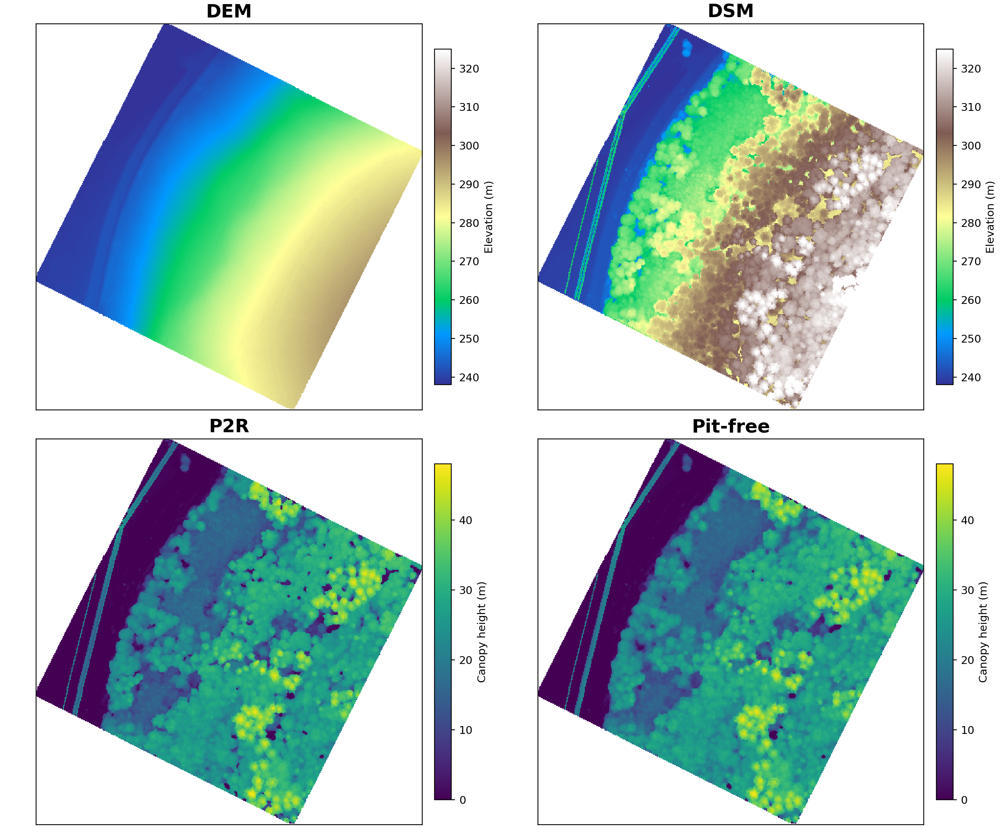
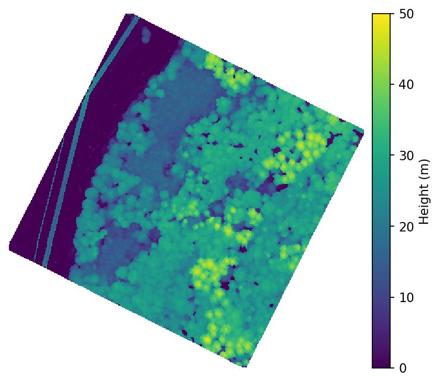
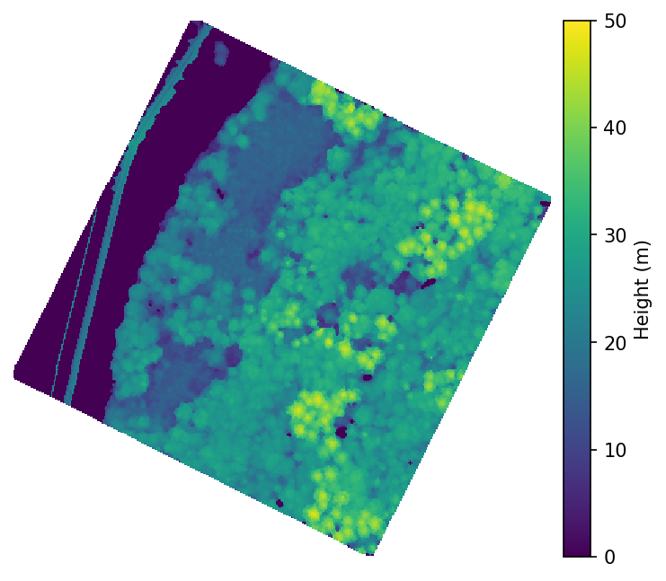
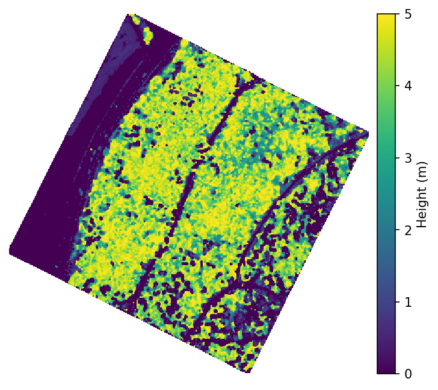
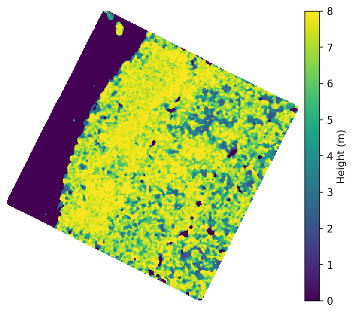
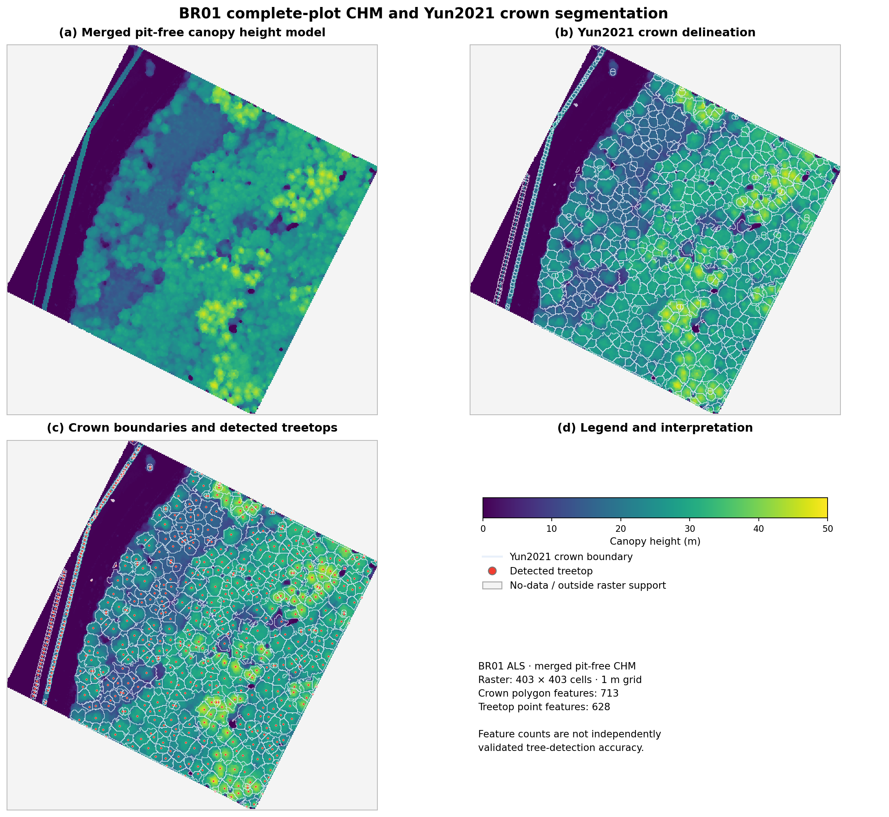

# Chapter 4 — FAST-GC ground classification, core products, and wall-to-wall LiDAR mapping

**Study design:** a complete airborne laser scanning (ALS) survey for measured examples; operational workflows also apply to uncrewed laser scanning (ULS) and terrestrial laser scanning (TLS), with sensor-specific tuning.
**Scope:** reproducible processing and deliverables, **not** the mathematical ground-filtering algorithm. Hydrological and terrain analysis are covered in the next chapter.

## 4.1 From classified points to continuous maps

FAST-GC processes LAS/LAZ surveys through ground classification, optional height normalization, and raster surface generation. The *core* output is a classified point cloud; DEM, DSM, normalized cloud, and CHM are direct products of the processing pipeline. Terrain derivatives, hydrology, canopy structure, and tree-level analysis are downstream applications, not synonyms for ground classification.

| Product | Meaning | Typical use | Notes |
|---|---|---|---|
| `FAST_GC` | Ground/non-ground classified point cloud | Terrain support, quality control | Preserve original survey metadata and inspect class counts |
| `FAST_DEM` | Digital Elevation Model: ground elevation | Terrain reference | A grid's no-data cells are not zero elevation |
| `FAST_DSM` | Digital Surface Model: upper observed surface | Surface/canopy representation | Includes buildings and other above-ground objects where present |
| `FAST_NORMALIZED` | Point cloud expressed as height relative to DEM | Canopy and vertical-profile analysis | Height depends on DEM quality and sampling |
| `FAST_CHM` | Canopy Height Model: modeled height above terrain | Canopy surface and tree applications | Different reconstruction methods may give different surfaces |
| `FAST_TERRAIN`, `FAST_STRUCTURE`, etc. | Downstream analytical products | Terrain/hydrology/forest characterization | Covered separately to avoid duplication |

**Wall-to-wall** refers to a spatially continuous mapped study footprint assembled from tiled processing. It does **not** mean every raster cell must contain an observation: no-data gaps and sparse point support remain possible. The processing buffer provides neighboring context; the intended tile core must govern the final mosaic to avoid duplicate edge observations.

## 4.2 Processing modes and their use

| Workflow | Intended operation | Appropriate situation |
|---|---|---|
| `run` | Process an input directly | Single, manageable file without tiling |
| `tile-only` | Generate reusable spatial tiles | Inspect coverage or stage later processing |
| `tile-run` | Tile and process | Keep processed tiles for inspection or later merge |
| `tile-run-merge` | Tile, process, and merge | Standard wall-to-wall survey workflow |
| `merge` | Merge existing processed tiles | Complete an interrupted or deliberately staged workflow |
| `derive-only` | Derive products from an existing processed root | Avoid redoing successful ground classification |

A workflow is **not** a product. For example, `tile-run-merge` can request `FAST_GC` alone for a benchmark or request classification, DEM, normalization, DSM, and multiple CHMs in one execution. Products are requested with `--products`; CHM variants are specified with `--chm_methods`.

## 4.3 Full-survey ALS example: BR01

The demonstration uses the *complete* BR01 ALS file, not the circular Plot 005 subset from Chapter 3. The file was provided and processed on Windows:

`G:\ALS_Jin\concurrent\BR01\ALS\ALS-on_BR01_2019-07-05_300m.laz`

### 4.3.0 Before running: verify the active CLI

Run in **Windows PowerShell** (not CMD or Python). The backtick `` ` `` must be the final character on each continued line: **no spaces after it**. Paste the complete command block, rather than typing `>>` prompts shown by PowerShell. Use `conda activate fastgc` to select the intended environment.

```powershell
conda activate fastgc
python -c "import fastgc; print(fastgc.__file__)"
fastgc --help
```

Check that the help lists `tile-run-merge`, `derive-only`, and the exact options in the chosen command. These preflight commands do not process LiDAR. The FAST-GC source archive used to review these examples is dated **2026-10-08**; a later installed release may differ. In particular, the successful BR01 individual-tree export depended on local fixes to the installed `treeclouds.py` that have **not yet been established as part of the public release**.

### 4.3.1 FAST_GC-only baseline

```powershell
fastgc `
  --in_path "G:\ALS_Jin\concurrent\BR01\ALS\ALS-on_BR01_2019-07-05_300m.laz" `
  --out_dir "G:\ALS_Jin\concurrent\BR01\ALS\BR01_FASTGC_140m" `
  --sensor_mode ALS `
  --workflow tile-run-merge `
  --products FAST_GC `
  --tile_size_m 140 `
  --buffer_m 4 `
  --jobs 8
```

| Parameter | Function | Configuration guidance |
|---|---|---|
| `--in_path` | LAS/LAZ file or input directory | Must exist; this path is specific to the BR01 workstation |
| `--out_dir` | Output root | Use a new directory for every independent benchmark |
| `--sensor_mode ALS` | Select airborne sensor pathway | Use `ULS` or `TLS` only for the corresponding survey |
| `--workflow tile-run-merge` | Create, classify, and merge tiles | Appropriate for continuous survey mapping |
| `--products FAST_GC` | Classification only | Isolates ground-processing runtime |
| `--tile_size_m 140` | Tile width in metres | Previously benchmarked; not a universal optimum |
| `--buffer_m 4` | Processing context around each tile, metres | Evaluate seams and point duplication at tile edges |
| `--jobs 8` | Parallel tile workers | Adjust to available memory and CPU; default `0` auto-selects workers |

**Observed result:** 9/9 tiles classified and merged, 12,531,911 points reported in merged FAST_GC output, and **7 min 23.04 s** end-to-end. The reported tiling stage took 26.97 s and merge 20.72 s. These are processing metrics, **not** ground-classification accuracy measurements.

### 4.3.2 Standard end-to-end command: ground, DEM, normalization, DSM, and CHM

```powershell
fastgc `
  --in_path "G:\ALS_Jin\concurrent\BR01\ALS\ALS-on_BR01_2019-07-05_300m.laz" `
  --out_dir "G:\ALS_Jin\concurrent\BR01\ALS\BR01_ALL_PRODUCTS" `
  --sensor_mode ALS `
  --workflow tile-run-merge `
  --products FAST_GC FAST_DEM FAST_NORMALIZED FAST_DSM FAST_CHM `
  --tile_size_m 140 `
  --buffer_m 4 `
  --jobs 8 `
  --grid_res 1.0 `
  --dem_method min `
  --chm_methods p2r p99 tin pitfree spikefree `
    percentile:pitfree:pct=5 `
    percentile_top:pitfree:low=5 `
    percentile_band:pitfree:low=2:high=8
```

| Parameter | Function | Configuration guidance |
|---|---|---|
| `--products` | Requests point-cloud and raster deliverables | `FAST_NORMALIZED` requires terrain support; DSM is included for spike-free routing |
| `--grid_res 1.0` | Raster cell size, in metres | 1 m used for all uploaded BR01 rasters; smaller cells need more point support |
| `--dem_method min` | DEM grid method | Minimum classified ground elevation; alternatives: `max`, `mean`, `nearest`, `idw` |
| `--chm_methods` | Multiple CHM outputs in one run | The six supported plain multi-method names are `p2r`, `p99`, `tin`, `pitfree`, `spikefree`, `csf_chm`; CSF is omitted here |
| `percentile:pitfree:pct=5` | Keep normalized points at or below 5 m, then apply pit-free reconstruction | Height-limited surface; `pct=5` is **not** a 5th-percentile statistic in this version |
| `percentile_top:pitfree:low=5` | Keep points at or above 5 m, then apply pit-free reconstruction | Useful for upper-canopy support; sparse gaps may remain |
| `percentile_band:pitfree:low=2:high=8` | Keep points between 2 and 8 m, then apply pit-free reconstruction | Height-stratum product; never interpret as full canopy height |

**CLI compatibility note.** The installed CLI advertises `adaptive_pitfree` for `--chm_method`, but the multi-target parser rejects it under `--chm_methods`. It is excluded from the runnable example. Do not include `adaptive_pitfree` in the multi-method example until its parser support is confirmed. FAST-GC should ideally validate all target names before starting expensive work.

**Command preconditions:** activate the `fastgc` environment, verify the input path exists, and choose a new output directory. These examples are for the specific BR01 path and should not be copied unchanged to another computer.

## 4.4 Tiled mapping: footprint, buffers, merge, and performance

The operational sequence is **source files → tiles with processing context → classified tiles → optional surface products → merged survey products**. For contiguous survey tiles, merging is necessary to provide a single study-area deliverable. Tile processing can be retained when individual tile quality control or staged recomputation is required.

The nominal tile size affects the number of tasks; the buffer affects the volume of duplicated processing context. Small tiles may increase task-launch and buffer overhead; large tiles may increase peak per-worker memory. More workers do not guarantee higher throughput when memory bandwidth or disk access becomes limiting.

### 4.4.1 Previously measured Site 5 benchmark

Site 5 is a separate ALS survey, approximately 500 × 500 m with about 3.5 million points. It was used to investigate performance and tiling on Windows 11. These figures should not be treated as direct comparisons with BR01 because survey size, point distribution, and processing context differ.

| Tile width | Buffer | Workers | Tiles | Elapsed time | Interpretation |
|---|---|---|---|---|---|
| 50 m | 3 m | 8 | 100 | 830.39 s (13.84 min) | Higher number of small tasks |
| 140 m | 4 m | 8 | 16 | 600.87 s (10.01 min) | Faster of these two measured runs |
| 140 m | 4 m | 6 | 16 | Approximately 10.5 min | Competitive alternative |

**Benchmark reporting:** state the operating system, FAST-GC version, CPU/RAM, tile width, buffer, workers, input point count, products, and whether the clock covers tiling, processing, and merging. Treat Windows and WSL2 results as different environments. The values above summarize earlier user-run benchmark records; raw logs should be retained alongside the final book for independent verification.

### 4.4.2 Multi-file and batch inputs

The CLI accepts a **directory** through `--in_path`; `--recursive` enables nested-directory scanning. A directory input is useful when an acquisition is delivered as several adjacent LAS/LAZ files. First check that all files share a compatible horizontal coordinate reference system, elevation units, and survey metadata. A directory of unrelated surveys should not be treated as one contiguous wall-to-wall area.

The following example is intentionally a *template*, not an executable BR01 command; it requires the reader to substitute a real existing directory:

```powershell
# Replace this path with a directory containing compatible LAS/LAZ files.
$surveyFolder = "C:\data\ALS\survey"
fastgc `
  --in_path "$surveyFolder" `
  --out_dir "$surveyFolder\FASTGC_WALL_TO_WALL" `
  --sensor_mode ALS `
  --workflow tile-run-merge `
  --products FAST_GC FAST_DEM FAST_NORMALIZED FAST_CHM `
  --tile_size_m 140 `
  --buffer_m 4 `
  --jobs 8 `
  --grid_res 1.0 `
  --dem_method min
```

| Parameter | Function | Configuration guidance |
|---|---|---|
| `$surveyFolder` | Validated source directory | Do not place unrelated acquisitions or incompatible CRSs together |
| `--in_path` | Directory of LAS/LAZ files | Use `--recursive` only if nested folders should be included |
| `--out_dir` | Separate output location | Prefer an output outside the input tree when recursive scanning is enabled |
| `--workflow tile-run-merge` | Survey-wide tiled processing and merge | Inspect the tile manifest and spatial coverage before interpreting a merged map |
| `--products` | Requested deliverables | This batch example uses the default CHM method unless overridden |

## 4.5 ALS, ULS, and TLS: operational distinctions

| Consideration | ALS | ULS | TLS |
|---|---|---|---|
| Acquisition geometry | Top-down airborne returns | Low-altitude airborne returns, often denser and more variable | Side-looking and multi-scan ground perspective |
| Ground support | Often spatially distributed beneath canopy gaps | Highly dependent on flight pattern and canopy penetration | Can be abundant near scanner but occluded behind vegetation and objects |
| Tiling | Survey-scale tiling generally appropriate | Adapt tile size to density and flight overlap | Start conservatively with dense scans; watch memory and per-tile point counts |
| Buffer | Required to stabilize tile-edge context | Evaluate across dense flight strips and edges | Consider scan occlusion and local neighborhood support |
| DEM/CHM | Typical forest and terrain products | Suitable where ground coverage supports normalization | Surface rasters may have severe occlusion/voids; inspect rather than assume full coverage |
| Validation | Ground control / independently labeled points | Ground control and flight-strip consistency | Scanner geometry, scan positions, and independent terrain reference |

The same **CLI interface** selects the mode with `--sensor_mode ALS`, `ULS`, or `TLS`. The best tile size, worker count, and buffer are **not transferable defaults**. For TLS especially, dense interior tiles may be slower or memory-bound. Do not imply that an ALS runtime benchmark predicts TLS performance.

### 4.5.1 Sensor-specific command patterns and initial tile settings

These are **preflight templates, not benchmark-validated ULS/TLS commands**. Confirm the installed FAST-GC CLI version and inspect the source LAS/LAZ before running. Use a dedicated output folder outside the input folder. The numbers are conservative *trial configurations*, not fixed recommendations; record the point count, area, and maximum per-tile point density before tuning.

| Sensor | Initial tile width | Buffer | Workers | Why start here? |
|---|---:|---:|---:|---|
| ALS | 140 m | 4 m | 6–8 | BR01 and Site 5 provide a measured ALS reference; reduce workers if RAM is limited |
| ULS | 50–100 m | 5 m | 2–4 | Denser acquisition and variable flight overlap may increase per-tile memory |
| TLS | 10–25 m | 2–3 m | 1–2 | Very dense near-scanner points can make even small tiles expensive |

**ULS — start with ground classification, DEM, normalization, and CHM**

```powershell
$source = "C:\data\ULS\survey.laz"
$output = "C:\data\FASTGC_RESULTS\ULS"

if (-not (Test-Path -LiteralPath $source -PathType Leaf)) {
    throw "ULS input LAS/LAZ does not exist: $source"
}

fastgc `
  --in_path "$source" `
  --out_dir "$output" `
  --sensor_mode ULS `
  --workflow tile-run-merge `
  --products FAST_GC FAST_DEM FAST_NORMALIZED FAST_CHM `
  --tile_size_m 75 `
  --buffer_m 5 `
  --grid_res 1.0 `
  --chm_method pitfree `
  --jobs 2
```

| Parameter | Function / definition | Configuration guidance |
|---|---|---|
| `$source`, `--in_path` | Source LAS/LAZ file | Replace example path; script checks existence |
| `$output`, `--out_dir` | Dedicated output root | Keep separate from input and other experiments |
| `--sensor_mode ULS` | ULS processing pathway | Only use for ULS acquisitions |
| `--workflow tile-run-merge` | Tile, process, merge | Inspect tile count, merged LAS, and raster seams |
| `--products` | Ground, DEM, normalized LAS, CHM | Check terrain quality before interpreting canopy height |
| `--tile_size_m 75` | 75 m processing tile | Trial setting; reduce for high point density |
| `--buffer_m 5` | 5 m neighborhood context | Check edge effects and overlap |
| `--grid_res 1.0` | 1 m output raster cells | Adjust to observed ground support |
| `--chm_method pitfree` | Primary CHM reconstruction | Produces a single CHM variant |
| `--jobs 2` | Two concurrent workers | Increase only after monitoring peak memory |

**TLS — start with ground classification, DEM, and normalization**

```powershell
$source = "C:\data\TLS\survey.las"
$output = "C:\data\FASTGC_RESULTS\TLS"

if (-not (Test-Path -LiteralPath $source -PathType Leaf)) {
    throw "TLS input LAS/LAZ does not exist: $source"
}

fastgc `
  --in_path "$source" `
  --out_dir "$output" `
  --sensor_mode TLS `
  --workflow tile-run-merge `
  --products FAST_GC FAST_DEM FAST_NORMALIZED `
  --tile_size_m 20 `
  --buffer_m 3 `
  --grid_res 1.0 `
  --jobs 1
```

| Parameter | Function / definition | Configuration guidance |
|---|---|---|
| `$source`, `--in_path` | Source TLS LAS/LAZ | Replace example path; script checks existence |
| `$output`, `--out_dir` | Dedicated TLS output directory | Avoid mixing TLS and ALS outputs |
| `--sensor_mode TLS` | TLS-specific processing | Ground may be occluded behind stems and understory |
| `--workflow tile-run-merge` | Tile, classify, merge | Inspect tiles and coverage before downstream products |
| `--products` | Ground, DEM, normalized LAS | CHM omitted initially until ground and coverage are assessed |
| `--tile_size_m 20` | 20 m processing tile | Trial setting; smaller tiles may be needed for dense scans |
| `--buffer_m 3` | 3 m processing context | Inspect boundary continuity |
| `--grid_res 1.0` | 1 m DEM grid | Fine raster cells are not automatically better |
| `--jobs 1` | One processing worker | Establish baseline peak RAM and elapsed time |

**Validation rule:** report ULS/TLS runtime only after the actual commands complete with zero failed tiles and verified merged outputs. No ULS or TLS runtime is claimed in this chapter yet.

## 4.6 DEM: resolution and interpolation

A Digital Elevation Model is an estimate of terrain elevation on a regular grid. The chosen grid spacing determines how much detail can be represented, but a fine cell size does not create ground returns where none were observed. FAST-GC 0.2.1 exposes `min`, `max`, `mean`, `nearest`, and `idw` as `--dem_method` options.

| DEM method | Interpretation | Practical caution |
|---|---|---|
| `min` | Minimum classified ground elevation contributing to a cell | Sensitive to low outliers or misclassified points |
| `max` | Maximum contributing ground elevation | May emphasize high points in sloping cells |
| `mean` | Mean ground elevation | Smooths within-cell variation |
| `nearest` | Nearest-sample interpolation | Local abrupt transitions possible |
| `idw` | Inverse-distance-weighted interpolation | Neighborhood and distance assumptions affect surfaces |

For BR01, the supplied DEM was produced at **1 m** using the `min` setting. To compare methods or 0.5 m, 1 m, and 2 m grids, keep the same ground-classified input and evaluate terrain artifacts, missing cells, and runtime. Those comparisons have **not** been measured in the supplied BR01 raster set, so no superiority ranking is claimed.

[](../assets/chapter04/br01_core_surfaces.png)

*Figure 4.1. BR01 DEM, DSM, P2R CHM and pit-free CHM derived from the supplied GeoTIFFs. All four panels are clipped to the **same valid DSM footprint** for direct spatial comparison. DEM elevations are unchanged inside the footprint; outside cells are hidden only for visualization. Elevation and canopy-height color scales are separate. White indicates excluded or missing cells.*

## 4.7 CHM variants and percentile families

The CHM methods reconstruct canopy height from available observations and the terrain reference. They are **not interchangeable algorithms**; their differences should be evaluated against point density, canopy gaps, crown boundaries, and independent canopy-height evidence.

| CHM method | Working interpretation | Potential strengths / cautions |
|---|---|---|
| `p2r` | Point-to-raster canopy surface | Direct and simple; can contain sampling pits |
| `p99` | High-percentile canopy-height surface | Reduces sensitivity to isolated maxima; can suppress narrow crown peaks |
| `tin` | Triangulated surface | Interpolates between supports; can bridge real gaps |
| `pitfree` | Multi-layer pit-free canopy reconstruction | Can reduce pits; evaluate crown-edge smoothing and gap filling |
| `spikefree` | DSM-first spike-free reconstruction | May reduce spikes; depends on DSM routing and ground reference |
| `percentile` | Fareed (2026) height-filtered canopy reconstruction: retain points at or below `pct` height | This implementation's `pct` is a height threshold in metres, **not** a statistical percentile |
| `percentile_top` | Fareed (2026) upper-canopy point selection: retain points at or above `low` | Feed the retained upper points into a primary CHM algorithm such as `pitfree` |
| `percentile_band` | Fareed (2026) height-band point selection: retain points between `low` and `high` | Reconstruct the selected stratum; it is not a full-height CHM |

### Fareed (2026): height-selective CHM reconstruction

The **Fareed (2026) percentile family** adds a point-selection stage *before* the primary canopy-surface reconstruction. In the supplied FAST-GC implementation, selection is performed on the point-cloud **Z height** (typically height-normalized canopy points); the selected points are then processed by the named primary CHM method. This distinction matters: the implementation does **not** calculate a statistical 5th percentile from the height distribution when the selector is written as `pct=5`.

| Selector expression | Exact current selection rule | Subsequent reconstruction | Intended interpretation |
|---|---|---|---|
| `percentile:pitfree:pct=5` | Keep `z <= 5 m` | Pit-free CHM on retained points | Lower-height-limited surface; canopy maxima above 5 m are excluded |
| `percentile_top:pitfree:low=5` | Keep `z >= 5 m` | Pit-free CHM on retained points | Upper-canopy-focused surface retaining the actual height of selected points |
| `percentile_band:pitfree:low=2:high=8` | Keep `2 m <= z <= 8 m` | Pit-free CHM on retained points | Height-stratified surface, not whole-canopy maximum |

**Algorithmic sequence:** normalized canopy points → apply Fareed (2026) height selector → run primary CHM reconstruction (`pitfree` in these examples) → rasterize and merge. Thresholds refer to the Z values used by the implementation and should not be confused with quantile percentages. The terminology *percentile family* is retained as the software's method name; the threshold behavior is stated explicitly for reproducibility.

`csf_chm` is supported but deliberately excluded from this comparison. `adaptive_pitfree` appears in the primary CLI choices but was rejected by the installed multi-target parser; it is **not** listed as a working multi-target command.

### CHM variants — two-column comparison

The eight BR01 CHM variants are displayed in two columns. All maps use the same 1 m grid. Most panels use a common 0–50 m color scale; the two bounded selector outputs use their own scales and must not be compared by color intensity alone.

<table>
<tr>
<td width="50%" valign="top" align="center"><a href="../assets/chapter04/chm_individual/p2r.png"></a><p><strong>P2R</strong></p></td>
<td width="50%" valign="top" align="center"><a href="../assets/chapter04/chm_individual/p99.png"></a><p><strong>P99</strong></p></td>
</tr>
<tr>
<td width="50%" valign="top" align="center"><a href="../assets/chapter04/chm_individual/tin.png"></a><p><strong>TIN</strong></p></td>
<td width="50%" valign="top" align="center"><a href="../assets/chapter04/chm_individual/pitfree.png"></a><p><strong>Pit-free</strong></p></td>
</tr>
<tr>
<td width="50%" valign="top" align="center"><a href="../assets/chapter04/chm_individual/spikefree.png"></a><p><strong>Spike-free</strong></p></td>
<td width="50%" valign="top" align="center"><a href="../assets/chapter04/chm_individual/percentile_top_pitfree_low5.png"></a><p><strong>Percentile-top (low=5)</strong></p></td>
</tr>
<tr>
<td width="50%" valign="top" align="center"><a href="../assets/chapter04/chm_individual/percentile_pitfree_pct5.png"></a><p><strong>Percentile (pct=5)</strong></p></td>
<td width="50%" valign="top" align="center"><a href="../assets/chapter04/chm_individual/percentile_band_pitfree_low2_high8.png"></a><p><strong>Percentile-band (low=2, high=8)</strong></p></td>
</tr>
</table>

*Figure 4.2. BR01 CHM variants shown individually in a two-column layout. The Fareed (2026) variants filter input points by Z-height before CHM reconstruction; the comparison does not imply an accuracy ranking.*

### 4.7.1 Measured raster summary

All ten supplied rasters are **403 × 403 pixels, 1 m resolution, EPSG:25832**. The following values were calculated directly from valid GeoTIFF cells; they are not classification accuracy statistics.

| Raster | Minimum (m) | Mean (m) | Maximum (m) | Valid cells (%) |
|---|---:|---:|---:|---:|
| DEM | 236.54 | 263.12 | 295.49 | 77.2 |
| DSM | 237.12 | 283.72 | 336.24 | 56.5 |
| P2R | 0.0 | 20.14 | 47.34 | 56.5 |
| P99 | 0.0 | 19.94 | 47.15 | 56.5 |
| TIN | 0.0 | 20.14 | 47.34 | 56.5 |
| Pit-free | 0.0 | 20.56 | 47.34 | 56.5 |
| Spike-free | 0.0 | 19.74 | 47.24 | 56.5 |
| Percentile-top | 0.0 | 20.68 | 47.34 | 56.5 |
| Percentile pct=5 | 0.0 | 2.55 | 5.0 | 56.5 |
| Percentile band 2–8 | 0.0 | 5.31 | 8.0 | 56.5 |

**Interpretation warning.** The `percentile:pitfree:pct=5` output is bounded near 5 m and the `percentile_band:pitfree:low=2:high=8` output near 8 m. These maxima follow the configured height filters (`z <= 5 m` and `2 <= z <= 8 m`), not statistical percentile calculations. Similarly, equal P2R/TIN summary values do not prove pixel-by-pixel equality. Valid coverage also varies between DEM and canopy rasters; no-data must not be recoded as zero without a defensible reason.

## 4.8 CHM-based crown segmentation and individual-tree detection

A canopy height model is a height surface, not an individual-tree map. FAST_ITD delineates candidate crowns from a CHM, produces a crown-label raster and treetop locations, and exports a **combined crown shapefile**. FAST_TREECLOUDS subsequently uses the crown delineation to assign points in a normalized LAS to individual tree segments. These are distinct stages: a polygon is not itself a 3D tree point cloud.

### 4.8.1 Methods exposed by FAST-GC 0.2.1

The installed CLI advertises `placeholder`, `lmf`, `watershed`, `adaptive_watershed`, `yun2021`, `dalponte2016`, `li2012`, and `csp`. These are **available CLI choices**, not evidence that every method is CHM-only, equally mature, or equally accurate. The BR01 full-plot experiment selected **`yun2021`** after user visual comparison; no reference-based accuracy ranking was established. The `placeholder` option is not a scientific segmentation baseline.

### 4.8.2 Why use the merged CHM?

For the complete BR01 survey, the merged product directory contains a single pit-free CHM and a complete normalized LAS. Running on the merged CHM avoids dividing the crown delineation into nine independent tile-level rasters and provides one continuous label domain. Tiled processing remains useful for large surveys; merging is preferable only when the complete raster is spatially coherent and fits the available resources. The installed FAST_ITD resolver returned `merged_root`, one CHM raster, and the expected pit-free variant for this dataset.

The BR01 merged inputs used in the verified experiment are:

```text
ALS_tiles/Merged_ALS/
  ALS-on_BR01_2019-07-05_300m_FAST_CHM_pitfree.tif
  ALS-on_BR01_2019-07-05_300m_FAST_NORMALIZED.las
```

**Verified PowerShell command: FAST_ITD Yun2021 from the merged CHM**

```powershell
$merged = 'G:\ALS_Jin\concurrent\BR01\ALS\BR01_ALL_PRODUCTS\ALS_tiles\Merged_ALS'
$chm = Join-Path $merged 'ALS-on_BR01_2019-07-05_300m_FAST_CHM_pitfree.tif'
if (-not (Test-Path -LiteralPath $chm -PathType Leaf)) { throw "Merged CHM missing: $chm" }
fastgc `
  --in_path $merged `
  --sensor_mode ALS `
  --workflow derive-only `
  --products FAST_ITD `
  --itd_method yun2021 `
  --itd_source_chm pitfree `
  --itd_min_height 2.0 `
  --itd_crown_window_m 3.0 `
  --itd_min_peak_separation_m 1.5 `
  --jobs 1
if ($LASTEXITCODE -ne 0) { throw 'FAST_ITD failed' }
```

| Parameter | Function / definition | Configuration guidance |
|---|---|---|
| `$merged` | Existing complete-plot merged product directory | Validate it exists; BR01 workstation-specific path |
| `--in_path` | Root from which FAST_ITD resolves merged rasters | `Merged_ALS` was verified as `merged_root` in FAST-GC 0.2.1 |
| `--sensor_mode ALS` | Airborne laser scanning mode | Match acquisition type; not a claim about ULS/TLS performance |
| `--workflow derive-only` | Derive downstream products without ground reclassification | Requires existing CHM |
| `--products FAST_ITD` | Request crown delineation | Does not run tree-cloud extraction |
| `--itd_method yun2021` | Select tested crown segmentation method | Chosen for BR01 visual plausibility; no reference accuracy established |
| `--itd_source_chm pitfree` | Select merged pit-free CHM | Keep fixed for method comparisons |
| `--itd_min_height 2.0` | Minimum canopy/surface height threshold, m | BR01 tested setting; sensitivity should be evaluated |
| `--itd_crown_window_m 3.0` | Crown/treetop neighborhood window, m | BR01 tested setting; affects local separation |
| `--itd_min_peak_separation_m 1.5` | Minimum peak spacing, m | BR01 tested setting; may suppress adjacent small crowns |
| `--jobs 1` | Parallel workers | One complete raster; no inter-raster parallel benefit |

**Measured execution:** one merged raster, **5.96 s**, `ok=1`, `failed=0` (BR01 experiment, 13 October 2026). This measures execution, not delineation accuracy.



*Figure 4.3. Four-panel presentation of the actual BR01 merged pit-free CHM, Yun2021 crown boundaries, and detected treetops. The fourth panel contains the shared legend. The figure deliberately omits coordinate-system identifiers to prioritize interpretation. The crown layer has 713 polygon features and the treetop layer has 628 point features; feature counts should not be interpreted as validated numbers of individual trees.*

### 4.8.3 FAST_ITD deliverables

The observed complete-plot output was written under:

```text
Merged_ALS/FAST_ITD/yun2021/chm/pitfree/
  crowns/*_yun2021_crowns.shp
  treetops/*_yun2021_treetops.shp
  labels/*_yun2021_labels.tif
  qa/*_yun2021_filtered_chm.tif
  itd_manifest.json
  *_itd_result.json
```

A shapefile is a *multi-file dataset*: retain its `.shp`, `.shx`, `.dbf`, `.prj`, and other associated files together. The current verified output is **one combined crown shapefile containing many polygons**, not one shapefile per crown. Per-tree crown shapefile export is a proposed enhancement and should not be documented as a published feature. Keep the combined layer as the canonical GIS deliverable, and maintain stable crown/tree IDs when any per-tree export is introduced.

## 4.9 FAST_TREECLOUDS: from crown labels to individual-tree LAS

FAST_TREECLOUDS uses the existing FAST_ITD crown segmentation and the complete normalized LAS. For BR01, the downstream run was performed from the **same merged product root** as the Yun2021 stage. This is a separate derivation; no reclassification, DEM, or CHM generation is requested.

**Verified PowerShell command: full-plot tree-cloud segmentation**

```powershell
$merged = 'G:\ALS_Jin\concurrent\BR01\ALS\BR01_ALL_PRODUCTS\ALS_tiles\Merged_ALS'
$las = Join-Path $merged 'ALS-on_BR01_2019-07-05_300m_FAST_NORMALIZED.las'
$crowns = Join-Path $merged 'FAST_ITD\yun2021\chm\pitfree\crowns'
if (-not (Test-Path -LiteralPath $las -PathType Leaf)) { throw "Merged normalized LAS missing: $las" }
if (-not (Test-Path -LiteralPath $crowns -PathType Container)) { throw "Yun2021 crowns missing: $crowns" }
if (-not (Get-ChildItem -LiteralPath $crowns -Filter '*.shp' -File)) { throw 'No Yun2021 crown shapefile found' }
fastgc `
  --in_path $merged `
  --sensor_mode ALS `
  --workflow derive-only `
  --products FAST_TREECLOUDS `
  --itd_method yun2021 `
  --itd_source_chm pitfree `
  --treeclouds_las_source FAST_NORMALIZED `
  --treeclouds_min_height 0.5 `
  --treeclouds_write_individual `
  --jobs 1
if ($LASTEXITCODE -ne 0) { throw 'FAST_TREECLOUDS failed' }
```

| Parameter | Function / definition | Configuration guidance |
|---|---|---|
| `$merged` | Merged input and existing ITD product root | Must be the same root used by the Yun2021 run |
| `--in_path` | Downstream product discovery root | Complete BR01 merged directory, not the original raw LAZ |
| `--sensor_mode ALS` | ALS processing context | Keep consistent with upstream acquisition |
| `--workflow derive-only` | Reuse prior products | Does not request ground filtering or raster reconstruction |
| `--products FAST_TREECLOUDS` | Produce segmented tree clouds | Requires crown labels/polygons and LAS input |
| `--itd_method yun2021` | Select matching crown delineation | Must match the FAST_ITD run; avoids accidentally using watershed |
| `--itd_source_chm pitfree` | Select matching CHM variant | Must match existing crown product namespace |
| `--treeclouds_las_source FAST_NORMALIZED` | Use complete height-normalized LAS | Keep normalization consistent with DEM |
| `--treeclouds_min_height 0.5` | Minimum normalized point height, m | BR01 tested threshold; assess understory and low stems |
| `--treeclouds_write_individual` | Write individual-tree LAS files | In addition to the combined segmented LAS |
| `--jobs 1` | Dataset parallelism | One complete merged survey input |

**Measured execution:** one complete merged dataset, **6 min 24 s**, `ok=1`, `failed=0` (BR01 experiment, 13 October 2026). The execution succeeded, but no independent per-tree reference accuracy has been established. The output namespace follows `Merged_ALS/FAST_TREECLOUDS/yun2021/chm/pitfree/FAST_NORMALIZED/`; inspect the directory to verify actual LAS counts before reporting them.

### 4.9.1 LAS attributes and tree-cloud products

The BR01 combined segmented LAS exposes the following **extra dimensions**. These are identifiers and segmentation descriptors, not new physical measurements. Their exact relationships should be verified against the run's output manifest and the source label raster before interpreting tree counts.

| LAS attribute | Interpretation | How readers should use it |
|---|---|---|
| `tree_id` | Assigned individual-tree identifier | Group points for a tree; verify whether zero denotes unassigned points |
| `crown_id` | Crown-region identifier | Relate point groups to crown polygons/labels |
| `crown_uid` | Crown identifier intended for cross-product reference | Prefer for stable joins only after checking uniqueness |
| `parent_tree_id` | Parent tree association | Inspect for hierarchical/merged tree associations |
| `segment_id` | Segmentation region or object identifier | Trace subsegments where the implementation creates them |
| `obj_type` | Object/category code | Decode from the installed writer before assigning semantic class names |

A typical output root is `Merged_ALS/FAST_TREECLOUDS/yun2021/chm/pitfree/FAST_NORMALIZED/`. The workflow writes a combined LAS carrying segmentation attributes and, when `--treeclouds_write_individual` is enabled, an `individual_trees/` directory. Each individual-tree LAS should preserve its source point coordinates, normalised heights, and supported point attributes. Verify the actual output manifest and individual file counts before publication.

### 4.9.2 Interpreting segmentation and validating tree clouds

A successful extraction is not evidence that every crown corresponds to exactly one biological tree. Check crown/tree identifier consistency, duplicated IDs, canopy edge effects, point retention, and implausibly large or small individual-tree extents. The combined segmented LAS contains tree-related point attributes; the precise assignment behavior must be established from source and point records before drawing claims about understorey recovery or overlap handling. Visualize selected individual LAS clouds in 3D and compare them with the CHM-derived crown polygons.

### 4.9.3 Installation and release reproducibility

The BR01 merged-root Yun2021 FAST_ITD command succeeded using the installed CLI. FAST_TREECLOUDS also succeeded for the merged-root workflow. Separately, the same local Conda installation was patched in `fastgc/treeclouds.py` to (i) search the sibling `Merged_ALS` directory when invoked from `Processed_ALS`, and (ii) copy LAS headers when exporting subsets. **These are local installed-package changes, not confirmed changes to the published PyPI package or the development repository.** Readers using an unpatched installation should use the tested `Merged_ALS` root and verify their installed version; the final book should be synchronized with a tested release before asserting portability.

### 4.9.4 Future software validation

Exporting each crown as an individual shapefile, improving crown delineation with PyCrown-derived *ideas*, and ensuring matching tree IDs between polygon and LAS exports are development goals. PyCrown source integration requires a license and compatibility review; a controlled benchmark against the Yun2021 baseline is necessary before recommending an algorithm change. Preserve baseline outputs, run experiments in a separate namespace, and avoid treating geometric plausibility as reference-based accuracy.

## 4.10 Recovering products without reclassifying

A partially successful `tile-run-merge` job may leave classified tiles, DEM, and DSM already written. In that case, **do not automatically rerun ground classification**. Use `derive-only` on the existing `Processed_ALS` root after verifying required source folders. For the BR01 workspace used in the unsuccessful initial multi-target experiment, that root was:

`G:\ALS_Jin\concurrent\BR01\ALS\BR01_ALL_PRODUCTS_140m\ALS_tiles\Processed_ALS`

```powershell
fastgc `
  --in_path "G:\ALS_Jin\concurrent\BR01\ALS\BR01_ALL_PRODUCTS_140m\ALS_tiles\Processed_ALS" `
  --sensor_mode ALS `
  --workflow derive-only `
  --products FAST_NORMALIZED FAST_CHM `
  --grid_res 1.0 `
  --dem_method min `
  --jobs 8 `
  --chm_methods p2r p99 tin pitfree spikefree `
    percentile:pitfree:pct=5 `
    percentile_top:pitfree:low=5 `
    percentile_band:pitfree:low=2:high=8
```

| Parameter | Function | Configuration guidance |
|---|---|---|
| `--in_path` | Existing processed product root | Must contain `FAST_GC` and required upstream folders |
| `--workflow derive-only` | Reuse processed data | Avoids ground classification rerun |
| `--products FAST_NORMALIZED FAST_CHM` | Derive missing products | Existing DEM/DSM may be reused; inspect files before running |
| `--chm_methods` | Validated list of CHM targets | Never include `adaptive_pitfree` in the current multi-method parser |

**Version caution:** The installed `derive-only` source recognizes a `Processed_ALS` directory and checks for normalized data and DSM/DEM dependencies. Whether a particular output is skipped or overwritten depends on the installed version and its `--skip_existing` behavior. Back up results before experimentation.

## 4.11 Quality control and troubleshooting

| Symptom | Likely cause or interpretation | Recommended check |
|---|---|---|
| Input path not found | Placeholder or wrong drive/file | `Test-Path -LiteralPath "..."` before running |
| CHM method rejected after earlier stages | CLI/parser mismatch (`adaptive_pitfree`) | Use the validated multi-target list; validate early |
| Tile-edge seams | Inadequate context or merge issue | Inspect adjacent tile boundaries and core/buffer rules |
| Missing DEM cells | Sparse classified ground returns | Inspect ground density and classification, not just interpolation |
| CHM pits/spikes | Sampling gaps or surface reconstruction | Compare P2R, P99, pit-free, spike-free visually and against reference data |
| Height-limited Fareed (2026) selector outputs | Expected height-threshold point filtering | Check `pct`, `low`, `high` against intended canopy stratum |
| Excessive RAM/runtime | Dense tiles or excessive workers | Reduce concurrency or adjust tile dimensions |
| Mixed multi-file outputs | Incompatible source files or CRS | Validate each survey before wall-to-wall merge |

A successful command exit confirms execution, not accuracy. A book-quality validation should report ground/non-ground class counts, merged point preservation, seam checks, raster no-data coverage, CRS, and comparison to independent ground truth where available. Without such evidence, do not report accuracy metrics.

## 4.12 Reproducibility and next chapter

The BR01 dataset and GeoTIFF products provide a repeatable illustration of **ground classification → DEM → normalized points → DSM → alternative CHMs → Yun2021 ITD → FAST_TREECLOUDS**. Site 5 supplies a separate performance comparison. The reader should retain the original LAS/LAZ, processing manifest, command, software version, hardware description, output file inventory, and elapsed time. The next chapter treats terrain derivatives and hydrological analysis as a separate analytical stage built upon the DEM.

### Selected references

- Axelsson, P. (2000). DEM generation from laser scanner data using adaptive TIN models. *International Archives of Photogrammetry and Remote Sensing*, 33(B4), 110–117.
- Kraus, K., & Pfeifer, N. (1998). Determination of terrain models in wooded areas with airborne laser scanner data. *ISPRS Journal of Photogrammetry and Remote Sensing*, 53(4), 193–203.
- Khosravipour, A., Skidmore, A. K., Isenburg, M., Wang, T., & Hussin, Y. A. (2014). Generating pit-free canopy height models from airborne lidar. *Photogrammetric Engineering & Remote Sensing*, 80(9), 863–872.
- Isenburg, M. (2014). *LAStools: Efficient LiDAR Processing Software*. Software documentation.
