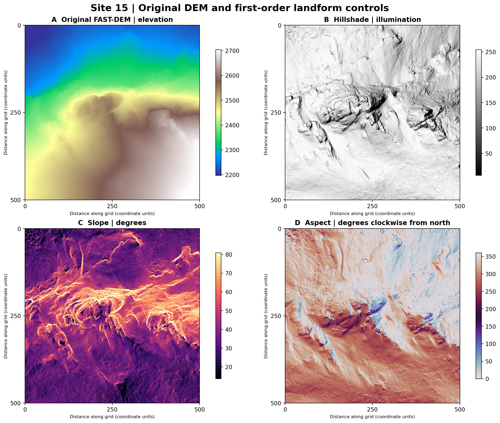
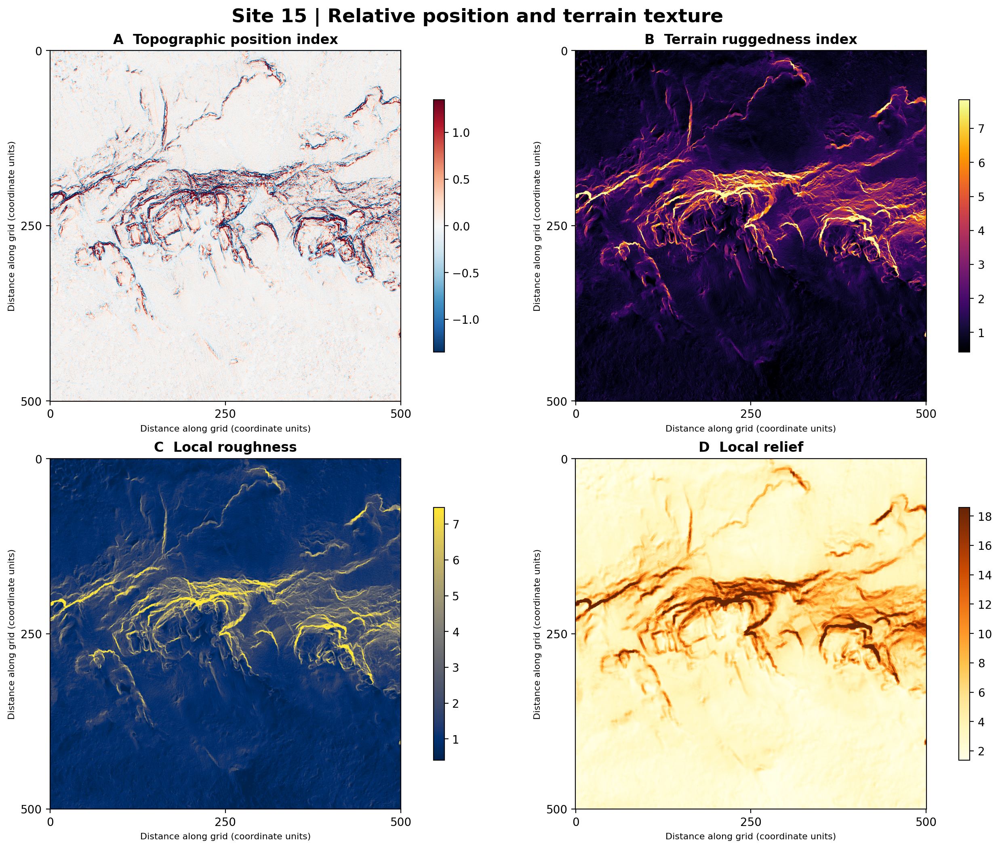
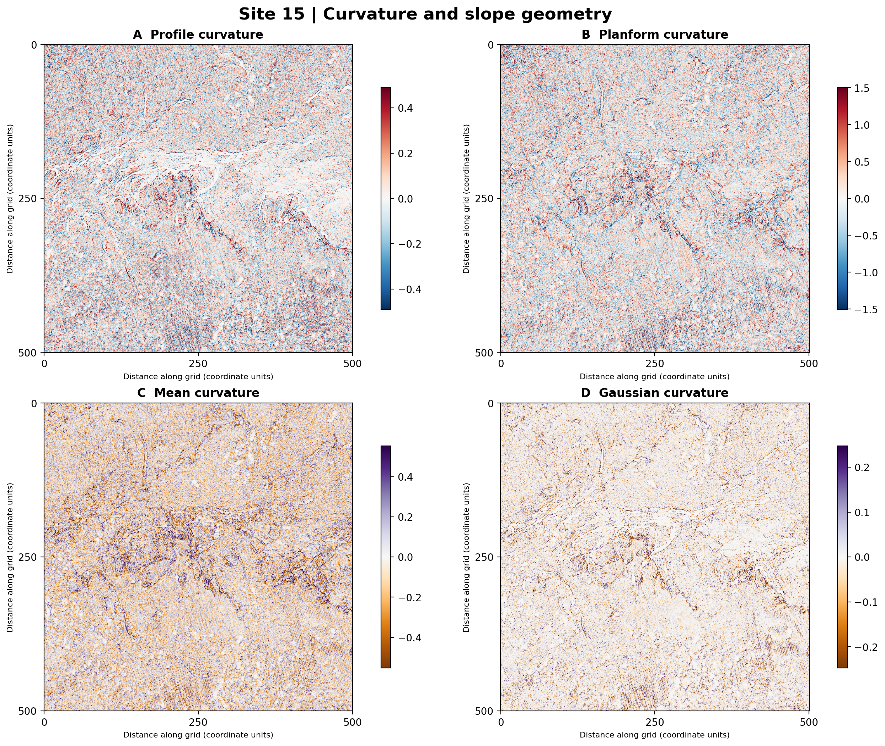
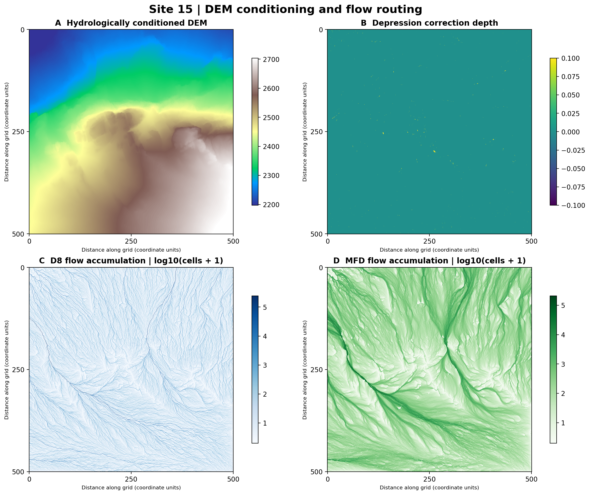
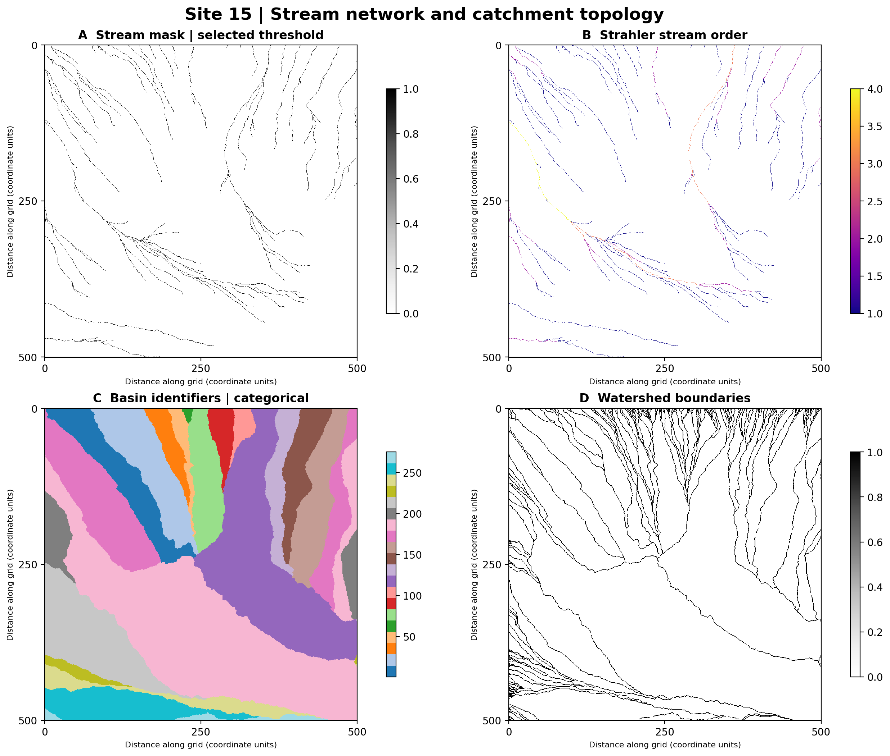
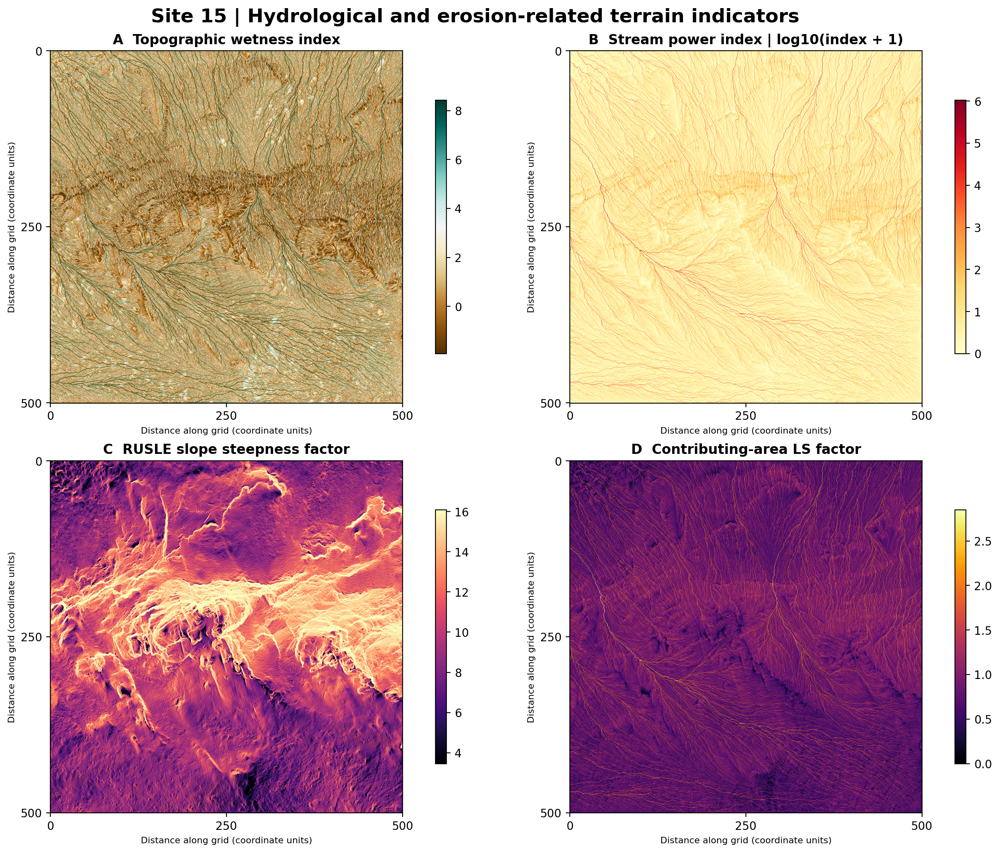

# Chapter 5 — From Elevation to Environmental Intelligence

*FAST-TERRAIN: terrain morphometry, drainage networks, watershed structure, and environmental applications.*

A digital elevation model (DEM) is more than a map of height. It is a numerical description of the land surface from which we can estimate local gradients, landscape position, drainage connectivity, and potential pathways for water and sediment. In forested terrain, these products provide physical context for understanding moisture redistribution, erosion exposure, forest accessibility, and the spatial setting of wildland fuels.

This chapter follows **Jin et al. Site 15**, corresponding to **FAST-GC benchmark Site 5**, from an existing airborne laser scanning (ALS) ground-classification product to continuous-domain terrain and hydrology derivatives. **The case study is a reproducible illustration of terrain analysis, not a validation of measured soil moisture, erosion, or fuel loads.**

## 5.1 Reference surface: the Site 15 FAST-DEM

The reference input is `Site15_FAST_DEM.tif`, derived from FAST-GC ground-classified ALS points. It is a **1,000 × 1,000-cell raster with 0.5 × 0.5 coordinate-unit spacing**, covering approximately **500 × 500 coordinate units**. Elevation values range from **2,175.60 to 2,727.11** (a 551.51-unit range). The source raster and the derivatives supplied for this chapter **lack an embedded coordinate reference system (CRS)**. The grid spacing is therefore verified, but **metre-based area and distance interpretation requires confirmation of the source horizontal and vertical units**. In the intended metre-based Site 15 processing workflow, the nominal cell size is 0.5 m and nominal area is 25 ha.

The original DEM is the common reference for every panel. This matters: a single continuous surface allows direct spatial comparison between slope, curvature, flow paths, catchments, and topographic indices without introducing differences from regridding or retessellation.



*Figure 5.1.* (A) Elevation from the original FAST-DEM, (B) hillshade as a visualization of relief, (C) slope in degrees, and (D) slope aspect. All four rasters share the same 1,000 × 1,000 grid. Color limits on continuous panels are robust visualization stretches, not changes to the underlying raster values. Axis distances are reported in grid-coordinate units because the files do not contain a CRS.

### How to interpret the reference surface

**Elevation** supplies absolute vertical context; **hillshade** makes ridges and valleys visually legible but depends on simulated illumination; **slope** measures local steepness and influences surface runoff, accessibility, and erosion potential; **aspect** gives the direction of steepest descent, an important covariate for radiation, drying, and vegetation microclimate. Aspect is circular (0° and 360° represent the same direction) and is less meaningful where the surface is nearly flat.

## 5.2 Reproducible native FAST-GC workflows

The public FAST-GC integration adds standalone DEM routing, continuous merged-DEM terrain derivation, and forwarding of terrain/hydrology options through FAST-GIS `plots-run`. The following PowerShell examples use the **public `fastgc` executable**, not a Python engine workaround. The documented workflow options have been checked against the installed FAST-GC command-line interface. The integrated Site 15 workflow has also been exercised on real ALS data; the standalone DEM command is documented separately and should not be described as independently benchmark-verified without an execution record.

### 5.2.1 Environment and source DEM validation

```powershell
conda activate fastgc
$dem = 'C:\Users\nadee.NFAREED1106\OneDrive\Pictures\Site15_FASTGC_50m\ALS_tiles\Merged_ALS\Site15_FAST_DEM.tif'
$out = 'C:\Users\nadee.NFAREED1106\OneDrive\Pictures\Site15_FAST_TERRAIN'
if (-not (Test-Path -LiteralPath $dem -PathType Leaf)) {
    throw "Missing source DEM: $dem. Find the actual merged Site15_FAST_DEM.tif before proceeding."
}
fastgc --help
if ($LASTEXITCODE -ne 0) { throw 'FAST-GC executable unavailable' }
```

| Parameter | Function / definition | Configuration guidance |
|---|---|---|
| `$dem` | Authoritative continuous DEM | Exact file path must exist; do not substitute a per-tile DEM |
| `$out` | Output directory | Use a separate destination to preserve the original DEM |
| `fastgc --help` | Inspect the installed public CLI | Confirm the installed version includes terrain/hydrology options |

### 5.2.2 Derive terrain and hydrology directly from the existing DEM

```powershell
fastgc --workflow derive-only `
    --in_path "$dem" `
    --out_dir "$out" `
    --products FAST_TERRAIN `
    --terrain_products all `
    --terrain_output both `
    --stream_threshold_area_m2 1000 `
    --stream_min_order 1
if ($LASTEXITCODE -ne 0) { throw 'Direct DEM terrain derivation failed' }
```

| Parameter | Function / definition | Configuration guidance |
|---|---|---|
| `--workflow derive-only` | Generate derivatives without rerunning ground classification | Use when an authoritative merged DEM already exists |
| `--in_path` | Input dataset | Supply the validated `.tif` DEM path |
| `--out_dir` | Output destination | Keep outputs separate from the source DEM |
| `--products FAST_TERRAIN` | Select terrain product family | Requires the integrated terrain-capable FAST-GC version |
| `--terrain_products all` | Select supported terrain derivatives | Check installed product registry; do not assume this means every optional product |
| `--terrain_output both` | Request raster and vector output modes | Vector products depend on supported hydrology options |
| `--stream_threshold_area_m2 1000` | Contributing-area threshold for stream initiation | Nominal 1,000 m²; physically valid only if horizontal units are metres |
| `--stream_min_order 1` | Minimum stream order exported | Order 1 includes headwater links |

### 5.2.3 Integrated ALS → tiles → merged DEM → terrain/hydrology

This route starts from the original ALS file and derives terrain from the **merged continuous DEM**, rather than processing drainage independently within each tile. The example below is a workflow template requiring confirmation of the installed CLI's tile/grid argument spellings before execution.

```powershell
$las = 'C:\Users\nadee.NFAREED1106\OneDrive\Pictures\Site15.las'
$runOut = 'C:\Users\nadee.NFAREED1106\OneDrive\Pictures\Site15_FASTGC_terrain_integrated'
if (-not (Test-Path -LiteralPath $las -PathType Leaf)) { throw "Missing LAS: $las" }
fastgc --workflow tile-run-merge `
    --in_path "$las" `
    --out_dir "$runOut" `
    --products FAST_GC FAST_DEM FAST_TERRAIN `
    --terrain_products all `
    --terrain_output both `
    --stream_threshold_area_m2 1000 `
    --stream_min_order 1
if ($LASTEXITCODE -ne 0) { throw 'Integrated ALS-to-terrain workflow failed' }
```

| Parameter | Function / definition | Configuration guidance |
|---|---|---|
| `--workflow tile-run-merge` | Tile, classify, merge, and derive products | Use for full LAS-to-terrain processing |
| `--in_path` | ALS LAS source | Must exist and match the intended survey |
| `--out_dir` | Full workflow destination | New directory prevents confusion with earlier benchmark products |
| `--products FAST_GC FAST_DEM FAST_TERRAIN` | Ground classification, DEM, and terrain | The terrain stage consumes the merged DEM |
| `--terrain_products all` | Terrain product selection | Confirm precise included products with the installed CLI |
| `--terrain_output both` | Raster and vector products | Verify resulting GeoTIFF and GeoPackage files |
| `--stream_threshold_area_m2 1000` | Channel initiation threshold | Report the unit assumption in the case study |
| `--stream_min_order 1` | Vector stream-order threshold | Order 1 retains headwaters |

### 5.2.4 Output verification and reproducibility

```powershell
$rasters = @(Get-ChildItem -LiteralPath $out -Filter '*.tif' -Recurse -File -ErrorAction SilentlyContinue)
$vectors = @(Get-ChildItem -LiteralPath $out -Filter '*.gpkg' -Recurse -File -ErrorAction SilentlyContinue)
if ($rasters.Count -eq 0) { throw "No terrain GeoTIFFs found under $out" }
$rasters | Select-Object Name, FullName, Length
$vectors | Select-Object Name, FullName, Length
```

| Parameter | Function / definition | Configuration guidance |
|---|---|---|
| `$out` | Expected terrain destination | Must match the preceding command |
| `*.tif` | Raster deliverables | Inspect grid dimensions, NoData, cell size, and value ranges |
| `*.gpkg` | Vector hydrology deliverables | Inspect layers, stream connectivity, and outlet topology |

**Scientific quality control:** check raster grid alignment and NoData semantics, D8/MFD accumulation-to-area conversion, stream-mask and stream-order coverage, drainage topology, basin boundaries, and whether the chosen threshold is appropriate. Passing automated tests does not substitute for comparison with observed hydrography.

## 5.3 Terrain morphometry: the shape of the forest landscape

### Slope and aspect — the first environmental gradients

**Slope (degrees)** is the angle of the local surface relative to horizontal. **Slope (percent)** expresses rise per 100 units of horizontal run. They are different representations of the same gradient, not two independent variables. Steeper terrain can increase downslope water and sediment transport and complicate mechanized access. **Aspect** indicates exposure, a useful predictor for spatial differences in solar radiation, evaporative demand, and vegetation conditions.

### Topographic position index (TPI) — ridge, midslope, or valley?

**TPI** compares a cell's elevation with the surrounding neighborhood. Positive values suggest locally elevated positions, negative values locally depressed positions, and values near zero intermediate or flat settings. Its interpretation depends on the neighborhood radius. **Applications:** landform classification, potential cold-air accumulation, and contextual stratification of vegetation and fuels.

### Terrain ruggedness index (TRI) — local relief complexity

**TRI** summarizes elevation differences between neighboring cells. Higher values indicate a more variable local surface. **Applications:** terrain accessibility, microsite heterogeneity, erosion-exposure covariates, and interpretation of heterogeneous forest stands.

### Roughness and local relief — complementary texture measures

**Roughness** quantifies local elevation variability under the implemented neighborhood definition. **Local relief** describes the vertical range or local contrast of the terrain. Both respond to topographic complexity, but their definitions and scales differ. **Applications:** characterizing dissected terrain, field-survey planning, and locating topographic transitions.



*Figure 5.2.* Four complementary descriptions of landscape position and texture derived from the same DEM. These indices should not be interpreted as direct measures of vegetation, surface fuel mass, or geomorphic process rates.

### Curvature — where terrain converges, diverges, or changes gradient

**Profile curvature** describes curvature along the direction of maximum slope and helps characterize changes in downslope gradient. **Planform curvature** describes curvature across the slope, relevant to geometric convergence and divergence of flow. **Tangential curvature** is another cross-slope curvature representation with implementation-specific normalization. **Mean curvature** and **Gaussian curvature** summarize surface geometry using principal curvatures; the latter is their product. **General curvature** is an additional terrain surface descriptor and should not be assumed interchangeable with any one of these measures.

Curvature sign conventions differ among implementations. **Do not assign “positive = convergent” or “negative = convex” without checking the FAST-GC formula and raster convention.** Extreme curvature values may also arise around abrupt relief and DEM artifacts; map displays use symmetric robust stretches to avoid letting a handful of outliers dominate the color scale.



*Figure 5.3.* Profile, planform, mean, and Gaussian curvature. Diverging palettes emphasize local sign and magnitude; panel-specific display limits are based on the 98th percentile of absolute values. Interpretation of positive and negative signs must follow the implementation convention.

## 5.4 Hydrological conditioning: preparing elevation for connected flow

### Conditioned DEM — a drainage-consistent working surface

The **conditioned DEM** is the input elevation surface after hydrological correction of depressions or flats as required by the routing algorithm. This does not mean every real depression is an error: closed basins, wetlands, and other natural features may be physically meaningful. Hydrological conditioning is a **modeling decision**, and the original DEM must remain available for comparison.

### Depression depth — where conditioning changes the surface

**Depression depth** records the elevation adjustment associated with conditioning. In the supplied Site 15 raster, **1,106 cells have positive values** and the maximum adjustment is approximately **3.54 elevation units**. Such maps help locate sensitive areas where drainage outcomes depend on how the surface is conditioned.

### D8 flow direction — one receiver per cell

**D8 (eight-direction) routing** assigns each cell to one downslope neighboring cell, producing a discrete drainage graph. It is useful for extracting concentrated drainage, tracing downstream connections, and defining basins, but can overconcentrate flow on divergent slopes.

### D8 flow accumulation — upstream support

**D8 flow accumulation** counts the cells draining to each location. **D8 contributing area** converts those counts to area by multiplying by the cell area. In the supplied rasters, this conversion is numerically exact: contributing area equals flow accumulation × **0.25 coordinate units²**. The derived **specific catchment area** normalizes area by an appropriate contour-width representation and is used by hydrological indices.

### Multiple flow direction (MFD) — distributed hillslope flow

**MFD** routes portions of flow toward multiple downslope neighbors rather than one receiver. It is often better suited to diffuse hillslope flow and divergent topography. The supplied MFD accumulation and contributing-area rasters have the same grid and area conversion relationship as the D8 products, but their spatial patterns can differ.



*Figure 5.4.* Hydrologically conditioned elevation, depression correction depth, and logarithmically displayed D8/MFD accumulation. Log scaling makes both minor hillslope contributions and strongly connected drainage corridors visible; it does not modify the stored accumulation values.

## 5.5 Drainage networks, stream hierarchy, and watersheds

### Stream mask — the candidate drainage network

A **stream mask** selects cells whose modeled contributing area exceeds a specified threshold. For this example the requested threshold is `1000.0` nominal m²; its physical meaning depends on confirming the raster's coordinate units. A threshold-derived stream network is **not** necessarily an observed perennial channel network.

### Strahler stream order — branching hierarchy

**Strahler order** labels stream branches according to their position in the network: headwater links start at order 1; two streams of equal order increase the downstream order by one. The uploaded Site 15 raster reaches **order 4**. Stream order helps summarize drainage hierarchy, network complexity, and the scale of contributing subcatchments.

### Stream links — discrete drainage segments

**Stream link IDs** identify individual connected network segments. The uploaded raster contains **146 distinct positive link IDs**. These IDs are identifiers, not rankings or physical measurements.

### Basin IDs and subcatchments — assigning land to drainage outlets

**Basin IDs** assign cells to drainage basins under the implemented routing and outlet definitions. The supplied raster has **275 distinct positive basin IDs**. **Subcatchment IDs** subdivide the terrain according to drainage-network structure. **Watershed boundaries** identify cells at basin or subcatchment divisions; their geometry is rasterized at the DEM resolution.



*Figure 5.5.* Stream presence, Strahler order, basin labels, and watershed boundaries. Categorical basin colors distinguish identifiers only; they do not indicate a continuous physical gradient. Stream-mask and stream-order products each contain **14,189 positive stream cells**, supporting internal consistency of their coverage.

## 5.6 Hydrology meets ecology: wetness, erosion, and wildfire context

### Topographic wetness index (TWI) — potential moisture redistribution

**TWI** combines upslope contributing area with local slope to represent **topographic tendency toward water accumulation or saturation**. High values often indicate convergent, low-gradient settings; low values often correspond to well-drained or steep positions. TWI is **not** a soil-moisture observation and omits rainfall, soil hydraulic properties, evapotranspiration, and groundwater dynamics.

**Useful for:** stratifying field soil-moisture sampling, mapping candidate moist refugia, exploring vegetation patterns, and adding terrain covariates to wildfire fuel-moisture models.

### Stream power index (SPI) — potential erosive concentration

**SPI** combines contributing area with terrain gradient as an index of potential flow energy or erosive concentration. Higher values can flag channels or hillslope convergence zones where runoff-driven sediment transport may be more likely, but SPI is **not** an observed erosion rate.

**Useful for:** screening drainage corridors, prioritizing erosion surveys, assessing post-fire runoff exposure, and supporting watershed risk analysis.

### RUSLE slope factor and contributing-area LS factor — topographic erosion susceptibility

The **RUSLE S factor** represents the steepness component used in the Revised Universal Soil Loss Equation framework. The **contributing-area LS factor** combines slope and upslope area in a terrain-based proxy for topographic erosion susceptibility. These are **components of erosion models**, not standalone soil-loss predictions. Soil erodibility, rainfall erosivity, vegetation cover, and management conditions are also required for complete modeling.

**Useful for:** identifying terrain where post-fire soil protection, erosion monitoring, or mitigation planning may deserve attention.



*Figure 5.6.* TWI, SPI, RUSLE S, and contributing-area LS factor. SPI and LS are displayed on logarithmic scales to reveal spatial structure across large value ranges. These maps express modeled terrain susceptibility or potential, not direct measurements of water content or sediment yield.

## 5.7 Product inventory and practical interpretation

All listed products are raster derivatives at **0.5 × 0.5 coordinate-unit resolution**, matching the supplied source DEM. Their units are product-specific; identifiers and direction codes are dimensionless.

| Product file stem | Definition | Illustrative application |
|---|---|---|
| `slope_degrees`, `slope_percent` | Terrain gradient in degrees or percent | Access, runoff, slope stability context |
| `aspect` | Downslope orientation | Radiation, drying, vegetation covariates |
| `hillshade` | Simulated relief illumination | Cartographic interpretation |
| `curvature` | General local surface bending | Landform transitions |
| `profile_curvature` | Along-slope curvature | Gradient transitions, flow acceleration context |
| `planform_curvature` | Across-slope curvature | Flow convergence/divergence context |
| `tangential_curvature` | Cross-slope surface bending | Geomorphometric characterization |
| `mean_curvature`, `gaussian_curvature` | Differential surface-shape descriptors | Landform classification |
| `tpi` | Elevation relative to neighbors | Ridge/valley positions, ecological stratification |
| `tri` | Neighbor elevation differences | Ruggedness, accessibility |
| `roughness` | Local elevation variability | Terrain texture |
| `local_relief` | Local vertical relief | Landscape dissection |
| `conditioned_dem` | Hydrologically corrected elevation | Flow-routing reference |
| `depression_depth` | Conditioning adjustment depth | Sensitivity and sink diagnostics |
| `d8_flow_direction` | Single-receiver routing direction | Drainage tracing |
| `d8_flow_accumulation` | D8 upstream contributing cell count | Channel initiation |
| `d8_contributing_area` | D8 accumulated planimetric area | Catchment support |
| `d8_specific_catchment_area` | D8 contributing area normalized by width | Wetness/erosion indices |
| `d8_downslope_flow_length` | Downstream routing distance | Flow-path analysis |
| `d8_longest_upslope_flow_length` | Longest upstream routing distance | Watershed path structure |
| `mfd_flow_accumulation` | Distributed upstream flow contribution | Diffuse hillslope flow |
| `mfd_contributing_area` | MFD contributing area | Hillslope water redistribution |
| `mfd_specific_catchment_area` | Width-normalized MFD area | Hydrological terrain indices |
| `stream_mask` | Threshold-derived drainage cells | Candidate channel network |
| `strahler_stream_order` | Hierarchical channel order | Drainage-network structure |
| `stream_link_id` | Unique stream-segment labels | Network segmentation |
| `basin_id` | Basin labels | Watershed partitioning |
| `subcatchment_id` | Subcatchment labels | Local drainage planning |
| `watershed_boundary` | Raster drainage divides | Basin boundaries |
| `topographic_wetness_index` | Terrain wetness propensity | Moisture covariate |
| `stream_power_index` | Flow-concentration/gradient index | Erosion screening |
| `rusle_s_factor` | RUSLE steepness factor | Erosion model input |
| `contributing_area_ls_factor` | Area–slope topographic factor | Erosion susceptibility |

## 5.8 Application pathways: choosing the right products

| Research or operational question | Strong starting products | What else is needed before making decisions? |
|---|---|---|
| Where might fuels remain relatively moist? | TWI, aspect, TPI, slope | Fuel type, canopy, soil, weather, measured fuel moisture |
| Where might runoff concentrate after wildfire? | D8/MFD accumulation, SPI, stream mask | Burn severity, rainfall intensity, soil infiltration, observed drainage |
| Which slopes may be more erosion-prone? | Slope, curvature, RUSLE S, LS factor | Soil erodibility, cover, rainfall erosivity, field validation |
| Where are ridge–valley environmental contrasts strongest? | TPI, local relief, TRI, curvature | Vegetation and microclimate observations |
| How are drainage basins connected? | Flow direction, basin ID, stream links, Strahler order | Verified outlets, projected CRS, hydrography/topology checks |
| Where should terrain-sensitive field plots be placed? | TPI, slope, aspect, TWI | Sampling design and independent site measurements |

### Example: linking terrain to wildfire fuel moisture

A practical analysis might compare **north- and south-facing slopes** (aspect), **valley bottoms and ridges** (TPI), and **potential accumulation zones** (TWI). These strata can guide targeted fuel-moisture sampling or serve as covariates in a predictive model. They do **not** establish that high TWI causes high fuel moisture: vegetation, substrate, season, weather, and canopy shading may modify or reverse the relationship.

### Example: screening post-fire hydrological exposure

Combine **flow accumulation** and **SPI** to locate convergent flow paths, **slope** and **LS factor** to characterize topographic susceptibility, and **basin IDs** to summarize exposure by watershed. This is a terrain-based screening workflow. A defensible hazard estimate still needs rainfall scenarios, burn severity, soil properties, and local observations.

## 5.9 Site 15 validation snapshot

The following checks use the supplied original GeoTIFFs, rather than screenshots:

| Check | Observed result |
|---|---|
| Source DEM | 1,000 × 1,000 cells; nominal spacing 0.5 |
| Elevation range | 2,175.60–2,727.11 |
| D8 area conversion | Contributing area = accumulation × 0.25, cell by cell |
| MFD area conversion | Contributing area = accumulation × 0.25, cell by cell |
| Positive depression correction | 1,106 cells; maximum approximately 3.54 |
| Stream-mask cells | 14,189 |
| Strahler-order positive cells | 14,189 |
| Maximum stream order | 4 |
| Positive stream-link identifiers | 146 |
| Positive basin identifiers | 275 |
| Raster CRS | Not embedded; requires authoritative source confirmation |

**Limitations.** The internal relationships demonstrate product coherence, **not independent hydrological accuracy**. Drainage paths, outlet locations, watershed boundaries, DEM vertical accuracy, and observed streams should be independently validated. The original DEM should not be silently overwritten by conditioning. A confirmed projected CRS is required before claiming metre-based flow lengths or area thresholds.

## 5.10 Key message

A single classified-ground DEM can support a connected suite of **geomorphometric**, **hydrological**, and **environmental** analyses. FAST-TERRAIN transforms elevation into complementary layers describing **where land rises or falls**, **how water may move**, **where drainage networks connect**, and **which landscape positions may warrant closer ecological or hazard investigation**. The strongest applications combine these terrain derivatives with independent forest, fuel, soil, climate, and field measurements rather than treating topographic indices as direct observations.

---

*Figure provenance:* six static PNG figures were previously generated from supplied GeoTIFF values. Before publication, copy and verify each referenced image in `docs/assets/figures/`; this draft does not bundle those image files. Continuous panels use robust color stretches and selected hydrological panels use logarithmic display transforms; these transformations affect presentation only. The full-resolution source rasters remain unchanged.
