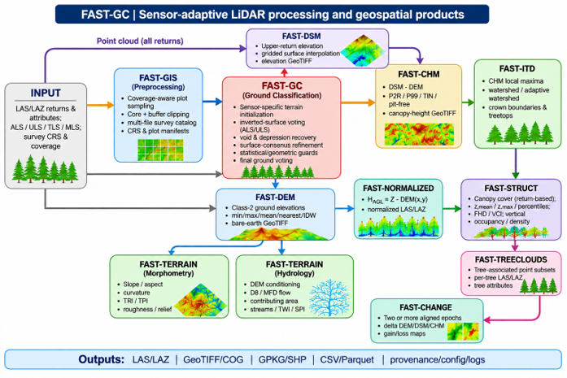
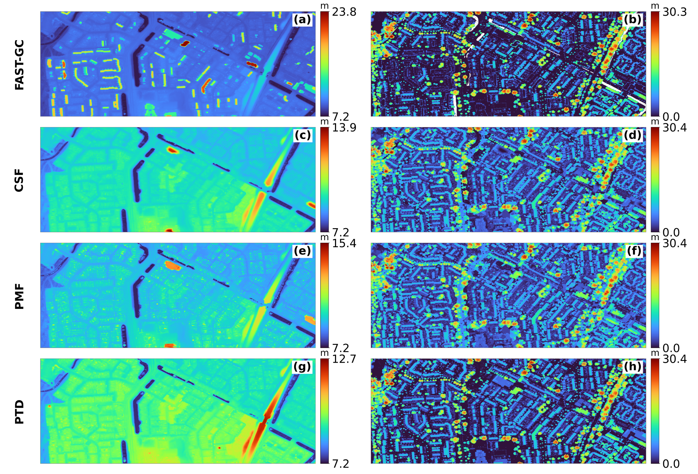
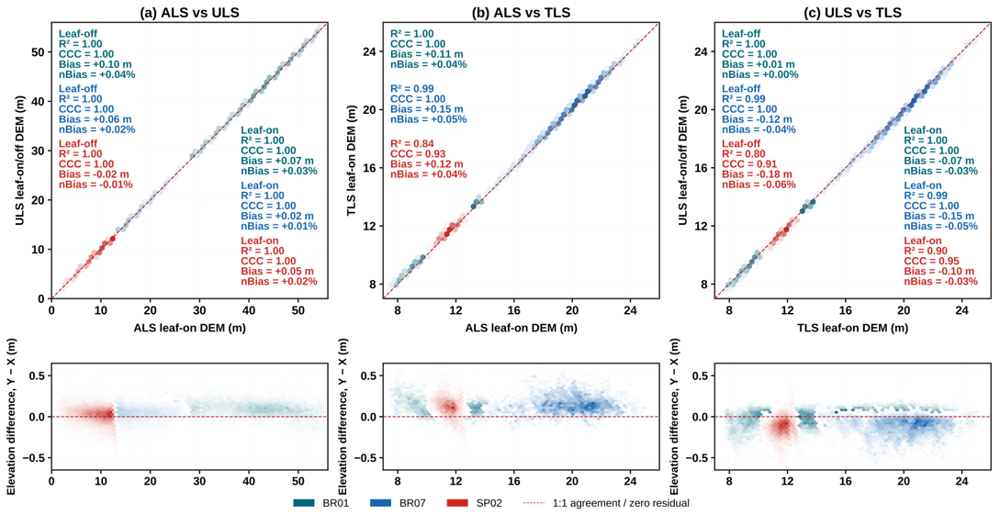
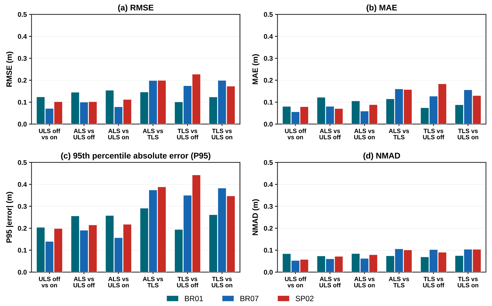
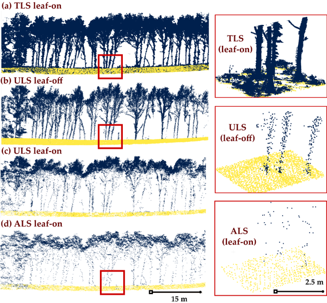
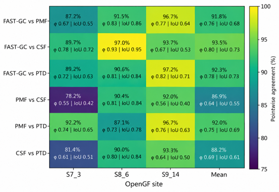
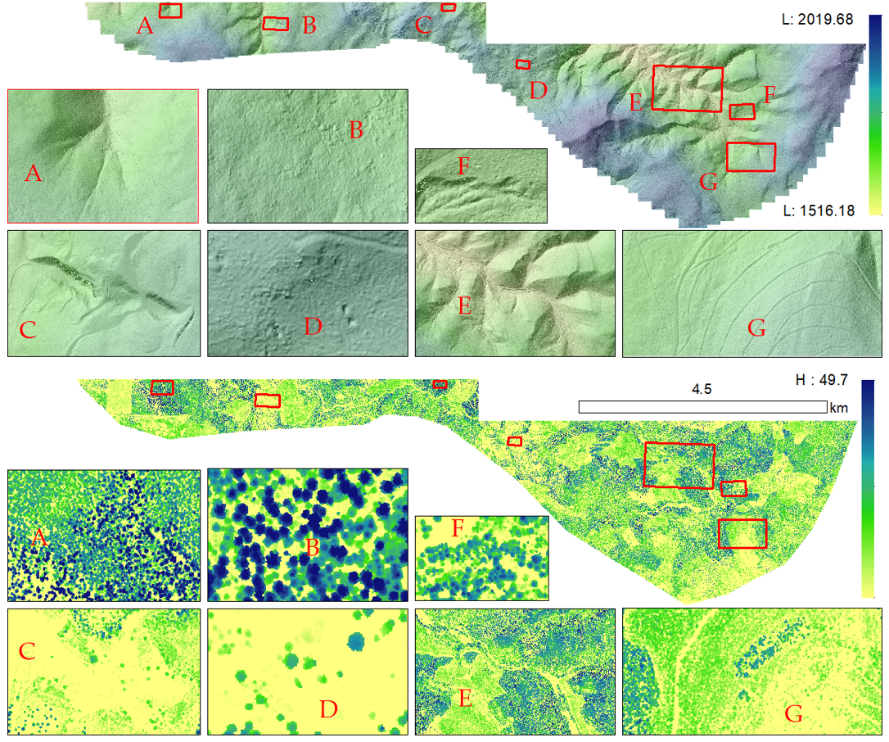

# Scientific Validation and Data Products

This chapter presents selected figures from the FAST-GC *Sensors* peer-review manuscript. Figures are identified by their manuscript numbering for traceability. The material illustrates software capabilities and experimental evidence; it does not imply that every product or site has been independently validated under all conditions.

## 6.1 Processing architecture and output families

*Manuscript Figure 1. FAST-GC processing architecture, from ALS/ULS/TLS point-cloud inputs through FAST-GIS preprocessing and sensor-aware ground classification to terrain, canopy, forest-structure, tree-cloud, and change products. Arrows depict product dependencies rather than performance measurements.*

## 6.2 Urban terrain and canopy products

*Manuscript Figure 4. Urban DEM (left) and CHM (right) visual comparisons for FAST-GC, CSF, PMF, and PTD. The terrain panels reveal differences in retained built structures and local ground elevations; the canopy panels show height products derived from the respective ground classifications. Color scales are shown independently for each panel.*

## 6.3 Cross-platform terrain consistency

See [Chapter 1, Section 1.4](../01-introduction/#14-cross-platform-consistency-als-uls-and-tls) for the interpretation of the two following figures.

*Manuscript Figure 10. ALS–ULS, ALS–TLS, and ULS–TLS pairwise 0.5 m DEM elevation comparisons across BR01, BR07, and SP02, with residual distributions below each scatterplot.*

*Manuscript Figure 11. RMSE, MAE, P95, and NMAD for leaf-on/leaf-off and cross-platform DEM comparisons, separated by site.*

*Manuscript Figure 12. Ground and vegetation observations under TLS leaf-on, ULS leaf-off, ULS leaf-on, and ALS leaf-on acquisition configurations, with enlarged ground patches. The panels illustrate how sensor viewpoint and occlusion change the availability and spatial distribution of terrain-supporting returns.*

## 6.4 Hierarchical stage-wise classification assessment

See [Chapter 2, Section 2.13](../02-installation/#213-stage-wise-ablation-and-algorithm-stability) for the interpretation of cumulative checkpoints versus controlled ablation.

*Manuscript Figure 13. ALS checkpoint performance for complex-vegetation Site 5 and complex-topography Site 15, including slope-stratified recall for Site 15.*

*Manuscript Figure 14. Spatial checkpoint maps for Site 15 showing correctly classified, newly recovered, omitted, and falsely classified ground observations.*

## 6.5 External classification agreement

*Manuscript Figure 15. Pairwise positive agreement, Matthews correlation coefficient (φ), and IoU among FAST-GC, PMF, CSF, and PTD for OpenGF mountainous scenes S7_3, S8_6, and S9_14. Agreement between algorithms is distinct from correctness against independently verified reference labels.*

## 6.6 Landscape-scale terrain and canopy products

*Manuscript Figure 16. Landscape-scale 0.5 m DEM (upper) and CHM (lower), with representative terrain and canopy details A–G. The enlarged regions illustrate spatial variation in relief and vegetation and allow visual inspection of continuity across the processed landscape.*

